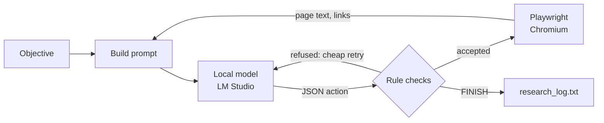

# LocalAgentBrowser

**An autonomous web agent powered by a local LLM. Give it an objective; it searches, reads, takes notes and
decides when it's done, all on your own computer.**

[](https://github.com/SnowFXXX/LocalAgentBrowser/actions/workflows/tests.yml)
[](LICENSE)

-green.svg)

<p align="center">
  
</p>

A local language model served by [LM Studio](https://lmstudio.ai) decides what to do next, and
[Playwright](https://playwright.dev/python/) carries it out in a visible Chromium window you can watch. Built
and tuned to work well with a **small 7B model on a CPU, no GPU required**.

- 🔒 **No cloud AI and no API keys.** The model runs in your own LM Studio.
- 🧭 **Goes from objective to findings unattended.** It searches, opens pages, reads long pages part by part,
  records what's relevant and finishes when the objective is met.
- 🛡️ **Keeps a small model on track.** Rules enforced in code stop loops, repeats and drifting, and the model
  is regularly asked to check its progress against the objective.
- ⚡ **Built for slow hardware.** It reuses LM Studio's prompt cache, so most turns process only what changed.
- 📝 **Everything is logged.** Every action, reason and finding goes to `research_log.txt` after every turn.
- ✅ **Tested.** 67 tests on Linux and Windows, Python 3.10–3.13, run in about a second with no model or browser.

## Contents

[Quick start](#quick-start) · [What a run looks like](#what-a-run-looks-like) · [How it works](#how-it-works) ·
[Settings](#settings) · [Performance](#performance) · [FAQ](#faq) · [Limitations](#limitations) ·
[Roadmap](#roadmap) · [Contributing](#contributing)

## Quick start

1. Install [LM Studio](https://lmstudio.ai), download a model (developed with **Qwen2.5-7B-Instruct**),
   load it and start the local server (Developer tab → Start Server).
2. Install the agent:

   ```bash
   git clone https://github.com/SnowFXXX/LocalAgentBrowser.git
   cd LocalAgentBrowser
   python -m venv venv
   ```

   Activate the virtual environment (`venv\Scripts\activate` on Windows, `source venv/bin/activate` on macOS
   and Linux), then:

   ```bash
   pip install -r requirements.txt
   python -m playwright install chromium
   ```

3. Run it and type your objective:

   ```bash
   python agent_browser.py
   ```

   Or install it as a command with `pip install .` and run `localagentbrowser`. Press Ctrl+C at any time to
   stop; findings so far stay in `research_log.txt`.

## What a run looks like

An excerpt from a real run (using the [live test runner](#testing), which adds the timing lines). The
objective was to find the setup commands for Playwright's built-in test agents. Here the agent tries to leave
a page without recording anything, is asked to confirm, then records setup commands from the official docs:

```text
🧠 [TURN 4/100] Active reasoning cycle executing...
⚡ Continuing the conversation (follow-up 3/12, ~4198 tokens)
   (model call 194.2s, prompt=3837 tok, completion=69 tok)
♻️ Cheap retry 1/2: [NAVIGATE] refused. You are about to leave https://qaskills.sh/blog/playwright-init-agents-guide
   without recording anything from it. 10 of its 11 parts are still unread. ...
   (model call 43.0s, prompt=4001 tok, completion=66 tok)
🎬 Chosen Action: [NAVIGATE] -> Parameter: https://playwright.dev/docs/test-agents

🧠 [TURN 6/100] Active reasoning cycle executing...
⚡ Continuing the conversation (follow-up 5/12, ~5199 tokens)
   (model call 60.9s, prompt=5231 tok, completion=101 tok)
💡 Agent Thoughts: The page also mentions other terminal commands and setup details for different coding
   agents like Claude Code, Codex, and OpenCode. I will DISCOVER these commands as well...
🎬 Chosen Action: [DISCOVER] -> Parameter: npx playwright init-agents --loop=claude
npx playwright init-agents --loop=codex
npx playwright init-agents --loop=opencode
```

That run (version 1.27) finished on its own on turn 13, after about 36 minutes, having recorded:

- the setup command `npx playwright init-agents` and its `--loop` options (`vscode`, `claude`, `codex`, `opencode`)
- what each agent does: the planner explores the app and writes a Markdown test plan, the generator turns
  the plan into tests, and the healer runs the tests and repairs failures
- the project layout the agents use (`.github/` for agent definitions, `specs/` for plans, `tests/` for
  generated tests and the seed test)

## How it works

Each turn, the model sees the objective, what it has found so far, a journal of its recent actions and the
current page, and answers with exactly one JSON action:

| Action | What it does |
|---|---|
| `SEARCH` | Searches DuckDuckGo (HTML version) and shows a numbered list of results with their real URLs |
| `NAVIGATE` | Opens a URL taken from the results or from the current page's links |
| `READ_MORE` | Shows the next part of a long page (pages are read in parts of about 2,500 characters) |
| `DISCOVER` | Records information from the current page as a finding |
| `FINISH` | Ends the run with a summary |



### Keeping a small model on track

- **Rules enforced in code, not just stated in the prompt.** Repeated searches, visiting the current page,
  empty or duplicate findings and impossible `READ_MORE` requests are refused, and the model is told why.
  Duplicate findings are recognised even when reworded into different lines, punctuation or order.
- **Cheap retries.** A refused reply is corrected inside the same turn by appending a short note to the
  conversation, instead of wasting a whole turn.
- **Confirm before leaving.** Leaving a page without recording anything from it triggers one check: record
  something, or repeat the action to leave.
- **Progress and objective checks.** After 4 turns without a new finding, and every 8 turns regardless, the
  model is asked to compare its findings with the objective, then finish or name what is still missing.
  These checks are what got the agent to finish on its own.
- **Readable pages.** Navigation menus, footers and cookie banners are hidden; code blocks and tables are
  never split between parts; links already shown are not repeated.

### Built for slow hardware

On a CPU, reading the prompt is about 90% of the time of every model call, and LM Studio can skip whatever
part of a prompt matches the start of its previous one. So the agent keeps one growing conversation and only
appends what changed (a short result, the next page part or a new page), building a fresh prompt only when
the conversation nears the context limit. The journal uses a compact one-line-per-entry format.

## Settings

| Environment variable | Default | Meaning |
|---|---|---|
| `LMSTUDIO_BASE_URL` | `http://localhost:1234/v1` | Address of the OpenAI-compatible server |
| `LMSTUDIO_MODEL` | `qwen2.5-7b-instruct` | Model identifier as the server lists it |
| `LMSTUDIO_API_KEY` | `lm-studio` | API key, if your server requires one |
| `LMSTUDIO_CONTEXT_LENGTH` | `8192` | Context length the model is loaded with; the conversation budget follows it |

Behaviour limits (part size, retry counts, check intervals and so on) are named constants at the top of
`agent_browser.py`, each with a comment explaining it.

## Performance

Measured on an Intel i5-9500 (6 cores, no GPU) with Qwen2.5-7B-Instruct Q4_K_M at an 8,192-token context:

| Kind of turn | Typical time |
|---|---|
| Follow-up on the same page (finding recorded, retry) | 35–60 s |
| Next part of a page, or a new page appended | 100–230 s |
| Fresh prompt (start, or after the context budget is reached) | about 240 s |

A GPU or a smaller model will be much faster.

## FAQ

**Does it need a GPU?**
No. It was developed entirely on a CPU. A GPU just makes each turn faster.

**Which models work?**
It was developed and tested with Qwen2.5-7B-Instruct (Q4_K_M). Any instruction-tuned model that LM Studio
serves should work, as long as the server supports `response_format` with a JSON schema (LM Studio 0.3 and
later). Set `LMSTUDIO_MODEL` and `LMSTUDIO_CONTEXT_LENGTH` to match. Reports with other models are very welcome.

**Can I use another OpenAI-compatible server instead of LM Studio?**
Probably: point `LMSTUDIO_BASE_URL` at it. It has only been tested with LM Studio, and the speed tricks rely
on the server reusing cached prompt prefixes (llama.cpp-based servers do).

**Is anything sent to the internet?**
No AI service is involved, and nothing about your run is uploaded. The agent does browse the real web,
though: search queries go to DuckDuckGo, and pages it opens load normally, as if you visited them yourself.

**Where are the results?**
In `research_log.txt` in the folder you ran it from, updated after every turn, including the final summary.

**Why does a turn take minutes?**
On a CPU the model reads the prompt slowly (about 8 tokens per second on the development machine), so a
turn that brings in a new page takes a few minutes. See [Performance](#performance) and
[Built for slow hardware](#built-for-slow-hardware).

## Limitations

- **Tuned on one kind of task.** Development and live testing used documentation research objectives. The
  agent is meant to be general, but the rules and thresholds have not yet been tried on other kinds of tasks.
- **A small model's judgement is the ceiling.** It sometimes drifts to loosely related pages, prefers
  secondary sources and writes incomplete final summaries; the full findings are always in `research_log.txt`.
- **Reading only.** The agent searches, opens pages and reads them. It does not click, fill in forms or sign in.
- **Web pages go into the prompt.** A page can contain text written to manipulate the model (prompt
  injection), so treat findings as unverified. See [SECURITY.md](SECURITY.md).
- **One search provider.** DuckDuckGo's HTML search occasionally returns an error page; the agent retries once.

## Roadmap

- [ ] Try different kinds of objectives and adjust the rules that don't generalise
- [ ] Include every finding in the final report, not only the model's own summary
- [ ] Make fresh prompts (the slowest kind of turn) cheaper
- [ ] Interacting with pages (clicking, forms) for tasks beyond reading

Ideas and requests are welcome in [issues](https://github.com/SnowFXXX/LocalAgentBrowser/issues).

## Testing

The test suite runs in about a second and needs neither LM Studio nor a browser: the model and the website
are replaced by scripted fakes, including an end-to-end run of the main loop.

```bash
pip install -r requirements-dev.txt
python -m pytest
python -m ruff check .
```

To try the real agent with a fixed objective and a time limit, logging the time and tokens of every model
call:

```bash
python tools/live_test.py "Your objective here" --minutes 25
```

## Contributing

Contributions are welcome! See [CONTRIBUTING.md](CONTRIBUTING.md) for setup and guidelines, and please follow
the [Code of Conduct](CODE_OF_CONDUCT.md). Security issues: see [SECURITY.md](SECURITY.md).

## Project history

Every version is a tagged commit, and [CHANGELOG.md](CHANGELOG.md) describes what changed in each one and
why, with the measurements behind the decisions.

## Acknowledgements

Versions 1.13 onwards were developed together with [Claude](https://www.anthropic.com/claude) (Anthropic),
working in Claude Code; those commits list Claude as co-author. Built on [LM Studio](https://lmstudio.ai),
[Playwright](https://playwright.dev/python/) and the [OpenAI Python library](https://github.com/openai/openai-python).

## License

[MIT](LICENSE) © 2026 SnowFX
