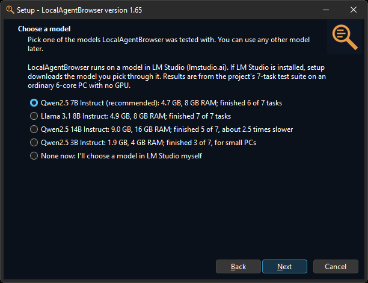
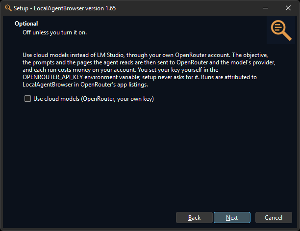

# LocalAgentBrowser

**An autonomous web agent powered by a local LLM. Give it an objective; it searches, reads, takes notes and
decides when it's done, on your own computer, with a local model or, if you choose, a cloud one. It gives an answer
you can check, or says honestly what it couldn't find.**

**New in 1.65:** a [Windows installer](#windows-the-installer-recommended) with a choice of tested models, and optional
cloud models through [OpenRouter](https://openrouter.ai) for fast answers.

[](https://github.com/SnowFXXX/LocalAgentBrowser/actions/workflows/tests.yml)
[](https://pypi.org/project/localagentbrowser/)
[](https://github.com/SnowFXXX/LocalAgentBrowser/blob/main/LICENSE)


<p align="center">
  
</p>

A language model decides what to do next, and [Playwright](https://playwright.dev/python/) carries it out in a
Chromium window you can watch. By default the model runs in [LM Studio](https://lmstudio.ai) on your own computer,
and the agent is built to work even with a **small model on an ordinary CPU, no GPU required**; if you want speed, it
can use a cloud model instead. Every claim in its answer points to the page it came from.

- 🔒 **Local by default, cloud if you choose.** By default the model runs in your own LM Studio, with no API key, and
  your objective and report stay on your computer (searches go to DuckDuckGo and pages load like in any browser).
  Cloud models through OpenRouter are an option you turn on yourself, with your own key: much faster, but your
  prompts and the pages read leave your computer.
- ✅ **Checks instead of trust.** Findings must be copied from the page shown, commands must appear on the page
  exactly, and numbers no finding gives are cut. What it can't find is listed as not found, not filled in.
- 🧭 **Unattended.** It searches, opens pages, reads long pages part by part, records what's relevant and finishes
  when every part of the objective is covered.
- 📝 **A report every time.** The final result with numbered citations and every finding with its source, written
  however the run ends.
- 🪟 **Easy on Windows.** An installer with its own Python, a choice of tested models during setup, Start-menu
  shortcuts, and the report opening by itself when a run ends.

📖 [Project site](https://snowfxxx.github.io/LocalAgentBrowser/) ·
[Article: We Can Do Better: A Small AI That Can't Cover Up](https://snowfxxx.github.io/LocalAgentBrowser/article.html) ·
[Paper: Verification over Trust](https://snowfxxx.github.io/LocalAgentBrowser/paper.html) ·
[Example reports](https://github.com/SnowFXXX/LocalAgentBrowser/blob/main/docs/examples/README.md)

## Contents

[Tested on four models](#tested-on-four-models) · [Install](#install) · [First run](#first-run) ·
[What a run looks like](#what-a-run-looks-like) · [How it works](#how-it-works) · [Settings](#settings) ·
[FAQ](#faq) · [Limitations](#limitations) · [Roadmap](#roadmap) · [Testing](#testing) · [Contributing](#contributing)

## Tested on four models

Releases that change how the agent works are measured on the same seven tasks, one of each kind it's built for: a
fact, a list with conditions, a comparison with a recommendation, a how-to, an explanation, views from several
sources, and a lookup in official documentation. In 1.64, four models ran them with identical code, 90 minutes per
task, on an ordinary 6-core PC with no GPU (Intel i5-9500). 1.65 adds the installer and optional cloud models
without changing how the agent works with a local model, so these results still apply:

| Model (Q4_K_M) | Download | RAM | Tasks finished | Model time | Gaps filled from its own knowledge |
|---|---|---|---|---|---|
| **Qwen2.5-7B-Instruct** (default) | 4.7 GB | 8 GB | 6 of 7 | 361 min | 0 |
| **Llama-3.1-8B-Instruct** | 4.9 GB | 8 GB | **7 of 7** | 303 min | 0 |
| **Qwen2.5-14B-Instruct** | 9.0 GB | 16 GB | 5 of 7 | 565 min | 0 |
| **Qwen2.5-3B-Instruct** | 1.9 GB | 4 GB | 3 of 7 | 490 min | 0 |

- **No finished result filled a gap from the model's own knowledge**, on any model.
- **Llama finished every task.** Read by hand, its results contain no invented facts; its mistakes lean cautious
  (a "not found" for something its findings do give).
- **The 14B** is about 2.5 times slower on a CPU; its two time-outs came while a correct answer was being checked.
- **The 3B** fits small PCs. It finished 3 tasks (none on 1.63), and one of them has a claim the checks missed.
- On 1.63 the same models finished 6, 2, 2 and 0 of 7. Every step and run is in the
  [regression history](https://github.com/SnowFXXX/LocalAgentBrowser/blob/main/docs/regression-history.md).

**Cloud models** (1.65) run the same code much faster, through your own OpenRouter account. A first suite run on
1.65 with the cloud version of the default model (`qwen/qwen-2.5-7b-instruct`) finished 7 of 7 in 2.3 minutes of
model time, with no gaps filled from the model's own knowledge by the suite's measures. Read by hand, two results
leave lines uncited that their findings do support, and the documentation answer came from a tutorial instead of
the official docs it was asked to use, without saying so. That's one run: a first look, not a measurement.

**Which to pick:** the 7B for most PCs, Llama if you have the same 8 GB and want it to finish more often, the 3B for
a PC with little memory. Any instruction-tuned model LM Studio serves should work.

## Install

### Windows: the installer (recommended)

1. Install [LM Studio](https://lmstudio.ai) (free). You don't need to download a model in it yet. (Not needed if
   you'll only use cloud models.)
2. Download **`LocalAgentBrowser-1.65-setup.exe`** from the
   [latest release](https://github.com/SnowFXXX/LocalAgentBrowser/releases/latest) and run it.
   - Windows may say **"Windows protected your PC"**, because the installer isn't code-signed yet. Click
     **More info → Run anyway**.
   - It installs for your Windows account only, with no administrator rights, and brings its own Python.
3. Setup asks what to install (LocalAgentBrowser, and optionally the test suite), which of the four tested models to
   download through LM Studio, and whether to use cloud models (off unless you tick it). It then downloads the
   Chromium browser the agent uses (about 150 MB, once).
4. Open **LocalAgentBrowser** from the Start menu or the desktop.

<p align="center">
  
  
</p>

To remove it: **Start menu → LocalAgentBrowser → Uninstall LocalAgentBrowser**, or Windows Settings → Apps. Your
reports in Documents are kept.

### Any system: pip

You need Python 3.10 or later, and [LM Studio](https://lmstudio.ai) (free) to run the model, unless you use cloud
models.

```bash
python -m venv venv
venv\Scripts\activate
pip install localagentbrowser
python -m playwright install chromium
```

On macOS or Linux, activate with `source venv/bin/activate` instead.

### From source

```bash
git clone https://github.com/SnowFXXX/LocalAgentBrowser.git
cd LocalAgentBrowser
python -m venv venv
venv\Scripts\activate
pip install -r requirements.txt
python -m playwright install chromium
```

Run it with `python agent_browser.py`.

### Windows shortcuts from a clone

The installer adds these for you. From a clone (above), with its packages installed in a `venv` folder inside it:

```bash
powershell -ExecutionPolicy Bypass -File tools\windows\make_shortcuts.ps1
```

This adds **LocalAgentBrowser** to the Start menu and the desktop. The launcher checks that LM Studio is answering
(or, with cloud models on, that your key is set),
runs each objective in its own folder under **Documents\LocalAgentBrowser runs**, and opens the report as a page in
your browser when the run ends.

## First run

1. In LM Studio, load your model with a **context length of 8192** (the agent's default; LM Studio's own default may
   differ) and start the local server (Developer tab → Start Server). With cloud models turned on, skip this step and
   set your OpenRouter key in the `OPENROUTER_API_KEY` environment variable instead (without the installer, see
   the [FAQ](#faq) for the other settings).
2. Start LocalAgentBrowser: the Start-menu shortcut on Windows, or `localagentbrowser` in a terminal.
3. Type your objective, for example *What is the tallest mountain in Africa, and how tall is it in meters and in
   feet?* A Chromium window opens and the agent starts working. The first step takes a minute or two on a CPU.
4. When it finishes, the report opens in your browser (Windows launcher), or read `research_report.md` in the folder
   you ran it from. Runs from the shortcut each get their own folder under **Documents\LocalAgentBrowser runs**.

A run takes about 10 to 60 minutes on a CPU, and a few minutes with a cloud model. Press Ctrl+C at any time to stop; the report is still written with
everything found so far.

**Good objectives** are questions you'd research by reading pages: a fact, a list with conditions ("three free,
open-source alternatives to Photoshop"), a comparison, a how-to, an explanation, or what several sources say.
**Not yet:** anything behind a login, a form or a button (it reads pages; it doesn't click or type into them).

## What a run looks like

A real run of 1.64 with the default model on a CPU (with the timing lines the [test runner](#testing) adds;
repetitive lines left out). Objective: *"What is the tallest mountain in Africa, and how tall is it in meters and in
feet?"*

```text
📋 Splitting the objective into a checklist...
   (model call 117.4s, prompt=778 tok, completion=30 tok)
📋 Objective checklist:
1. What is the tallest mountain in Africa? (discoveries for it: none yet)
2. How tall is it in meters? (discoveries for it: none yet)
3. How tall is it in feet? (discoveries for it: none yet)

🧠 [TURN 1/100] Active reasoning cycle executing...
   (model call 59.5s, prompt=926 tok, completion=78 tok)
🎬 Chosen Action: [SEARCH] -> Parameter: tallest mountain in Africa height in meters and feet

🧠 [TURN 2/100] Active reasoning cycle executing...
♻️ Cheap retry 1/2: [DISCOVER] refused. That is the search results page: its short descriptions are summaries
   written to be clicked, not sources. NAVIGATE to the result that looks right and DISCOVER from the page itself.
🎬 Chosen Action: [NAVIGATE] -> Parameter: https://en.wikipedia.org/wiki/Mount_Kilimanjaro

🧠 [TURN 3/100] Active reasoning cycle executing...
🎬 Chosen Action: [DISCOVER] -> Parameter: Mount Kilimanjaro is the highest mountain in Africa, rising to
   5,895 m (19,341 ft) at Uhuru Peak.

🧠 [TURN 4/100] Active reasoning cycle executing...
♻️ Cheap retry 1/2: [FINISH] refused. Your only discovery comes from
   https://en.wikipedia.org/wiki/Mount_Kilimanjaro. Consider whether the objective needs more. ...
   Before finishing, go through the OBJECTIVE CHECKLIST below ... and in thought_process write each item's
   number followed by the number of the discovery that covers it ...
💡 Agent Thoughts: 1: [1], 2: [1], 3: [1]
🎬 Chosen Action: [FINISH] -> Parameter: The tallest mountain in Africa is Mount Kilimanjaro, which stands at
   5,895 meters (19,341 feet) tall.
🔎 Checking each checklist item against the discoveries before finishing...
🎯 Agent has signaled mission complete. Writing the final result...
```

Four turns and 17.2 minutes of model time. The report it wrote:

> **Final result:** The tallest mountain in Africa is Mount Kilimanjaro [1]. It rises to 5,895 m (19,341 ft) at
> Uhuru Peak. The height in feet was found to be 19,341 ft [1].
>
> **Checklist**
> 1. What is the tallest mountain in Africa? (discoveries for it: [1])
> 2. How tall is it in meters? (discoveries for it: [1])
> 3. How tall is it in feet? (discoveries for it: [1])
>
> **Discoveries (1)**
> 1. Turn 3, from https://en.wikipedia.org/wiki/Mount_Kilimanjaro: *Mount Kilimanjaro is the highest mountain
>    in Africa, rising to 5,895 m (19,341 ft) at Uhuru Peak.*

The answer is right and every fact in it is in the finding, but it isn't polished: the second sentence has no
citation mark, and the third repeats the height. We show the run as it came out. Small writing slips like these are
on the list; invented facts are what the checks are there to stop.

## How it works

Each turn, the model sees the objective, what it has found so far, its recent actions and the current page, and
answers with one JSON action:

| Action | What it does |
|---|---|
| `SEARCH` | Searches DuckDuckGo and shows the results with their real addresses |
| `NAVIGATE` | Opens an address from the results or the current page's links |
| `READ_MORE` | Shows the next part of a long page (pages are read in parts of about 2,500 characters), or the unread part whose outline label names an item still missing |
| `DISCOVER` | Records something from the current page as a finding |
| `FINISH` | Ends the run, after each part of the objective is checked; the answer is then written in a separate step |

```text
Objective --> prompt --> model (LM Studio or cloud) --> one JSON action --> checks in code
                ^          ^                                                      |
                |          +--- refused: a cheap retry ---------------------------+
                |                                                                 |
                +--- page text, links <--- Playwright (Chromium) <--- accepted ---+
                                                                                  |
                                                        the report <--- FINISH ---+
```

The model proposes; code checks before anything is accepted:
- **A fixed checklist** of the objective's parts, made once at the start, that every later check uses.
- **Findings must come from the page:** they're compared with the page text shown, and commands must appear on the
  page exactly.
- **Finishing is checked part by part,** and the agent is sent back only for gaps the code can confirm: a part
  nothing answers, fewer things than asked for, missing amounts, a concrete missing term such as "O2".
- **The answer is written separately,** from the findings only. Names, numbers and commands no finding gives are cut
  and named, and parts nothing answers are listed as "Not found in the pages read".
- **Made to run on a CPU:** it reuses LM Studio's prompt cache, so most turns only process what changed.

The full details, code layout, timings and known limits:
[docs/how-it-works.md](https://github.com/SnowFXXX/LocalAgentBrowser/blob/main/docs/how-it-works.md).

## Settings

| Environment variable | Default | Meaning |
|---|---|---|
| `LMSTUDIO_BASE_URL` | `http://localhost:1234/v1` | Address of the OpenAI-compatible server |
| `LMSTUDIO_MODEL` | `qwen2.5-7b-instruct` | Model identifier as the server lists it |
| `LMSTUDIO_API_KEY` | `lm-studio` | API key, if your server requires one |
| `LMSTUDIO_CONTEXT_LENGTH` | `8192` | Context length the model is loaded with; the conversation budget follows it |
| `LMSTUDIO_EXTRA_BODY` | none | Extra JSON fields sent with every request, for other servers |
| `LMSTUDIO_EXTRA_HEADERS` | none | Extra HTTP headers sent with every request, as JSON |
| `OPENROUTER_API_KEY` | none | Your OpenRouter key for cloud models, read by the Windows launcher and the test suite's `--cloud` |
| `LAB_RUNS_DIR` | `regression_runs/` | Where the test suite puts its run folders |

The Windows installer writes the model you chose, and the cloud setting if you turned it on, to small files in its
`settings` folder. Behaviour limits are named constants in `localagentbrowser/config.py`, each with a comment.

## FAQ

**Does it need a GPU?** No. It was developed and tested entirely on a CPU. A GPU makes each turn faster. With cloud
models turned on, the model runs on the provider's computers instead of yours.

**Why does a turn take minutes on a CPU?** On a CPU the model reads the prompt slowly (about 8 tokens a second on the
development PC), so a turn that brings in a new page takes a few minutes. Most other turns reuse LM Studio's cache.
With cloud models turned on, a turn takes seconds.

**Is anything sent to the internet?** By default no AI service is involved and nothing about your run is uploaded.
The agent does browse the real web: searches, written from your objective, go to DuckDuckGo, and pages load
normally. If you turn on cloud models, the objective, the prompts and the pages read go to OpenRouter and the model's
provider.

**What are cloud models?** An option, off unless you turn it on, for people with an
[OpenRouter](https://openrouter.ai) account: the agent then uses a model in the cloud instead of LM Studio. It's much
faster, but it costs money on your account, and your prompts and the pages read leave your computer (the agent asks
providers not to store or train on them). You set your own key in the `OPENROUTER_API_KEY` environment variable; the
installer never asks for it. Cloud runs are listed under LocalAgentBrowser in OpenRouter's app rankings (no request
content is shared); to turn that off, delete the `LMSTUDIO_EXTRA_HEADERS` line in the installer's
`settings\cloud.cmd`.

**How do I turn on cloud models without the installer?** Set your key in `OPENROUTER_API_KEY`, then these, in
the same window before you start the agent. In Windows' command prompt:

```bat
set "LMSTUDIO_BASE_URL=https://openrouter.ai/api/v1"
set "LMSTUDIO_MODEL=qwen/qwen-2.5-7b-instruct"
set "LMSTUDIO_API_KEY=%OPENROUTER_API_KEY%"
set "LMSTUDIO_EXTRA_BODY={"provider": {"require_parameters": true, "data_collection": "deny"}}"
```

On macOS or Linux:

```bash
export LMSTUDIO_BASE_URL=https://openrouter.ai/api/v1
export LMSTUDIO_MODEL=qwen/qwen-2.5-7b-instruct
export LMSTUDIO_API_KEY="$OPENROUTER_API_KEY"
export LMSTUDIO_EXTRA_BODY='{"provider": {"require_parameters": true, "data_collection": "deny"}}'
```

The last line asks providers not to store or train on your prompts and to honour the JSON format. Any model
OpenRouter lists can go in `LMSTUDIO_MODEL`; this one is the cloud version of the default.

**Can I use another OpenAI-compatible server?** Probably: point `LMSTUDIO_BASE_URL` at it. The speed tricks rely
on the server reusing cached prompt prefixes (llama.cpp-based servers do).

**Where are the results?** When a run started from the Windows shortcut or the installed app ends, the report opens
in your browser by itself. The files are `research_report.md` (the answer and every finding with its source) and
`research_log.txt` (every action and reason), in the run's folder.

## Limitations

- **Whether a finding really answers a part is judged by the model, and it can be wrong.** The model can credit a finding about the
  right topic to the wrong part (a "create" command for "activate"), or put the wrong number on a citation. Check
  claims against the listed findings.
- **Reading only:** it doesn't click, fill in forms or sign in, and some sites refuse automated browsers.
- **Web pages go into the prompt,** so a page could try to manipulate the model (prompt injection); treat findings as
  unverified. See [SECURITY.md](https://github.com/SnowFXXX/LocalAgentBrowser/blob/main/SECURITY.md).
- **Seven kinds of task so far.** Others may expose new problems; reports are welcome.

More in [docs/how-it-works.md](https://github.com/SnowFXXX/LocalAgentBrowser/blob/main/docs/how-it-works.md#limitations).

## Roadmap

- [x] A fixed checklist, a coverage check verified in code, and every change measured on a regression suite (1.53–1.61)
- [x] Exact-text command checks, and four models measured on identical code (1.63)
- [x] Parts of the objective no longer dropped silently as often; the Windows launcher (1.64)
- [x] A Windows installer with its own Python and a choice of tested models, and optional cloud models (1.65)
- [ ] Count silent omissions in the regression suite, so [issue #11](https://github.com/SnowFXXX/LocalAgentBrowser/issues/11) can close on a number
- [ ] Decide in code, not by asking the model, whether a finding answers the part it's credited to
- [ ] A tray app on Windows: new research, progress, a notification when done
- [ ] Rewind dead ends: return to a saved point instead of carrying an unused page in every later prompt
- [ ] Interacting with pages (clicking, forms) for tasks beyond reading

Ideas and requests are welcome in [issues](https://github.com/SnowFXXX/LocalAgentBrowser/issues).

## Testing

The test suite runs in a few seconds with no model or browser: both are replaced by scripted fakes.

```bash
pip install -r requirements-dev.txt
python -m pytest
python -m ruff check .
```

To try the real agent with a fixed objective and a time limit, logging every model call:

```bash
python tools/live_test.py "Your objective here" --minutes 25
```

To measure a change on all seven kinds of task (several hours on a CPU), on any model you load into LM Studio:

```bash
python tools/regression.py --model qwen2.5-7b-instruct --baseline regression_runs/<earlier run>/summary.json
```

With `--cloud --model qwen/qwen-2.5-7b-instruct` the same suite runs on OpenRouter, with your key in
`OPENROUTER_API_KEY` (those runs are listed under LocalAgentBrowser in OpenRouter's app rankings).

Each run gets a folder in `regression_runs/` (or in the folder `LAB_RUNS_DIR` names; the installer's "Run the test
suite" shortcut uses Documents\LocalAgentBrowser test-suite runs) with every task's report, journal and prompt
trace, a `summary.md`
with honesty measures for each result, and `run_info.json` naming the PC and the exact code it ran. Results by kind
of task are in [docs/task-results.md](https://github.com/SnowFXXX/LocalAgentBrowser/blob/main/docs/task-results.md),
and every step since 1.53 in
[docs/regression-history.md](https://github.com/SnowFXXX/LocalAgentBrowser/blob/main/docs/regression-history.md).

## Contributing

Contributions are welcome! See [CONTRIBUTING.md](https://github.com/SnowFXXX/LocalAgentBrowser/blob/main/CONTRIBUTING.md)
and the [Code of Conduct](https://github.com/SnowFXXX/LocalAgentBrowser/blob/main/CODE_OF_CONDUCT.md). Security issues:
[SECURITY.md](https://github.com/SnowFXXX/LocalAgentBrowser/blob/main/SECURITY.md).

## Project history

Every released version is a tagged commit, and
[CHANGELOG.md](https://github.com/SnowFXXX/LocalAgentBrowser/blob/main/CHANGELOG.md) says what changed and why, with
the measurements behind each decision.

## Acknowledgements

Versions 1.13 onwards were developed together with [Claude](https://www.anthropic.com/claude) (Anthropic), working
in Claude Code; those commits list Claude as co-author. Built on [LM Studio](https://lmstudio.ai),
[Playwright](https://playwright.dev/python/), the [OpenAI Python library](https://github.com/openai/openai-python),
[OpenRouter](https://openrouter.ai) for the optional cloud models and, for the Windows installer,
[Inno Setup](https://jrsoftware.org/isinfo.php).

## License

[MIT](https://github.com/SnowFXXX/LocalAgentBrowser/blob/main/LICENSE) © 2026 SnowFX
