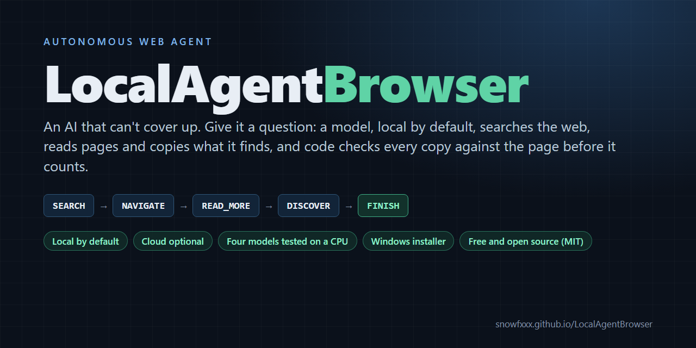
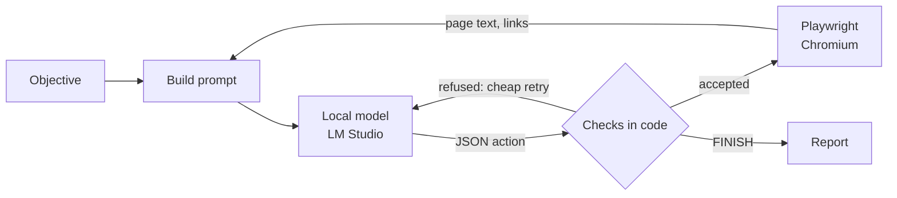

# LocalAgentBrowser

**An autonomous web agent powered by a local LLM. Give it an objective; it searches, reads, takes notes and
decides when it's done, on your own computer. It gives an answer you can check, or says honestly what it couldn't
find.**

[](https://github.com/SnowFXXX/LocalAgentBrowser/actions/workflows/tests.yml)
[](https://pypi.org/project/localagentbrowser/)
[](https://github.com/SnowFXXX/LocalAgentBrowser/blob/main/LICENSE)

-green.svg)

<p align="center">
  
</p>

A local language model served by [LM Studio](https://lmstudio.ai) decides what to do next, and
[Playwright](https://playwright.dev/python/) carries it out in a Chromium window you can watch. It is built for a
**small model on an ordinary CPU, no GPU required**, and every claim in its answer points to the page it came from.

- 🔒 **No cloud AI and no API keys.** The model runs in your own LM Studio; your objective, the model and the
  report stay on your computer. (Searches go to DuckDuckGo and pages load like in any browser.)
- ✅ **Checks instead of trust.** Findings must be copied from the page shown, commands must appear on the page
  exactly, and numbers no finding gives are cut. What it can't find is listed as not found, not filled in.
- 🧭 **Unattended.** It searches, opens pages, reads long pages part by part, records what's relevant and finishes
  when every part of the objective is covered.
- 📝 **A report every time.** The final result with numbered citations and every finding with its source, written
  however the run ends.
- 🪟 **Windows shortcuts.** A launcher with Start-menu and desktop shortcuts opens the report by itself when a run
  ends. A Windows installer is coming in the next release.

📖 [Project site](https://snowfxxx.github.io/LocalAgentBrowser/) ·
[Article: We Can Do Better: A Small AI That Can't Cover Up](https://snowfxxx.github.io/LocalAgentBrowser/article.html) ·
[Paper: Verification over Trust](https://snowfxxx.github.io/LocalAgentBrowser/paper.html) ·
[Example reports](https://github.com/SnowFXXX/LocalAgentBrowser/blob/main/docs/examples/README.md)

## Contents

[Tested on four models](#tested-on-four-models) · [Install](#install) · [First run](#first-run) ·
[What a run looks like](#what-a-run-looks-like) · [How it works](#how-it-works) · [Settings](#settings) ·
[FAQ](#faq) · [Limitations](#limitations) · [Roadmap](#roadmap) · [Testing](#testing) · [Contributing](#contributing)

## Tested on four models

Every release is measured on the same seven tasks, one of each kind it's built for: a fact, a list with conditions,
a comparison with a recommendation, a how-to, an explanation, views from several sources, and a lookup in official
documentation. In 1.64, four models ran them with identical code, 90 minutes per task, on an ordinary 6-core PC with
no GPU (Intel i5-9500):

| Model (Q4_K_M) | Download | RAM | Tasks finished | Model time | Gaps filled from its own knowledge |
|---|---|---|---|---|---|
| **Qwen2.5-7B-Instruct** (default) | 4.7 GB | 8 GB | 6 of 7 | 361 min | 0 |
| **Llama-3.1-8B-Instruct** | 4.9 GB | 8 GB | **7 of 7** | 303 min | 0 |
| **Qwen2.5-14B-Instruct** | 9.0 GB | 16 GB | 5 of 7 | 565 min | 0 |
| **Qwen2.5-3B-Instruct** | 1.9 GB | 4 GB | 3 of 7 | 490 min | 0 |

- **No finished result filled a gap from the model's own knowledge**, on any model.
- **Llama finished every task.** Read by hand, its results contain no invented facts; its mistakes lean cautious
  (a "not found" for something its findings do give).
- **The 14B** is about 2.5 times slower on a CPU; its two time-outs came while a correct answer was being checked.
- **The 3B** fits small PCs. It finished 3 tasks (none on 1.63), and one of them has a claim the checks missed.
- On 1.63 the same models finished 6, 2, 2 and 0 of 7. Every step and run is in the
  [regression history](https://github.com/SnowFXXX/LocalAgentBrowser/blob/main/docs/regression-history.md).

**Which to pick:** the 7B for most PCs, Llama if you have the same 8 GB and want it to finish more often, the 3B for
a PC with little memory. Any instruction-tuned model LM Studio serves should work.

## Install

You need [LM Studio](https://lmstudio.ai) (free), which runs the model, and Python 3.10 or later.

### Any system: pip

```bash
python -m venv venv
venv\Scripts\activate
pip install localagentbrowser
python -m playwright install chromium
```

On macOS or Linux, activate with `source venv/bin/activate` instead.

### From source

```bash
git clone https://github.com/SnowFXXX/LocalAgentBrowser.git
cd LocalAgentBrowser
python -m venv venv
venv\Scriptsctivate
pip install -r requirements.txt
python -m playwright install chromium
```

Run it with `python agent_browser.py`.

### Windows: Start-menu and desktop shortcuts

From a clone (above), with its packages installed in a `venv` folder inside it:

```bash
powershell -ExecutionPolicy Bypass -File tools\windows\make_shortcuts.ps1
```

This adds **LocalAgentBrowser** to the Start menu and the desktop. The launcher checks that LM Studio is answering,
runs each objective in its own folder under **Documents\LocalAgentBrowser runs**, and opens the report as a page in
your browser when the run ends.

**Coming in the next release:** a Windows installer that brings its own Python, lets you pick one of the four tested
models during setup, and adds the shortcuts for you.

## First run

1. In LM Studio, load your model with a **context length of 8192** (the agent's default; LM Studio's own default may
   differ) and start the local server (Developer tab → Start Server).
2. Start LocalAgentBrowser: the Start-menu shortcut on Windows, or `localagentbrowser` in a terminal.
3. Type your objective, for example *What is the tallest mountain in Africa, and how tall is it in meters and in
   feet?* A Chromium window opens and the agent starts working. The first step takes a minute or two on a CPU.
4. When it finishes, the report opens in your browser (Windows launcher), or read `research_report.md` in the folder
   you ran it from. Runs from the shortcut each get their own folder under **Documents\LocalAgentBrowser runs**.

A run takes about 10 to 60 minutes on a CPU. Press Ctrl+C at any time to stop; the report is still written with
everything found so far.

**Good objectives** are questions you'd research by reading pages: a fact, a list with conditions ("three free,
open-source alternatives to Photoshop"), a comparison, a how-to, an explanation, or what several sources say.
**Not yet:** anything behind a login, a form or a button (it reads pages; it doesn't click or type into them).

## What a run looks like

A real run (1.40, with the timing lines the [test runner](#testing) adds; repetitive lines left out). Objective:
*"What is the tallest mountain in Africa, and how tall is it in meters and in feet?"*

```text
🧠 [TURN 1/100] Active reasoning cycle executing...
   (model call 38.6s, prompt=676 tok, completion=54 tok)
🎬 Chosen Action: [SEARCH] -> Parameter: tallest mountain in Africa

🧠 [TURN 2/100] Active reasoning cycle executing...
💡 Agent Thoughts: From the search results, I can see that Mount Kilimanjaro is mentioned as the tallest
   mountain in Africa ... I will navigate to one of these pages to find the exact height in meters and feet.
🎬 Chosen Action: [NAVIGATE] -> Parameter: https://en.wikipedia.org/wiki/Mount_Kilimanjaro

🧠 [TURN 3/100] Active reasoning cycle executing...
🎬 Chosen Action: [DISCOVER] -> Parameter: Mount Kilimanjaro is the highest mountain in Africa, with an
   elevation of 5,895 m (19,341 ft) above sea level.

🧠 [TURN 4/100] Active reasoning cycle executing...
♻️ Cheap retry 1/2: [FINISH] refused. Your only discovery comes from
   https://en.wikipedia.org/wiki/Mount_Kilimanjaro. Consider whether the objective needs more. ...
   Before finishing, split the OBJECTIVE into its separate parts and, in thought_process, write each
   part followed by the discovery that covers it, or 'not covered'. ...
💡 Agent Thoughts: The objective has two parts: the name of the tallest mountain in Africa and its height
   in meters and feet. Both are covered by the discovery from Mount Kilimanjaro's Wikipedia page.
🎬 Chosen Action: [FINISH] -> Parameter: The tallest mountain in Africa is Mount Kilimanjaro ...
🎯 Agent has signaled mission complete. Writing the final result...
```

Four turns and 11.8 minutes of model time. The report it wrote:

> **Final result:** The tallest mountain in Africa is Mount Kilimanjaro [1], and its elevation is 5,895 meters
> (19,341 feet) above sea level [1].
>
> **Discoveries (1)**
> 1. Turn 3, from https://en.wikipedia.org/wiki/Mount_Kilimanjaro: *Mount Kilimanjaro is the highest mountain
>    in Africa, with an elevation of 5,895 m (19,341 ft) above sea level.*

## How it works

Each turn, the model sees the objective, what it has found so far, its recent actions and the current page, and
answers with one JSON action:

| Action | What it does |
|---|---|
| `SEARCH` | Searches DuckDuckGo and shows the results with their real addresses |
| `NAVIGATE` | Opens an address from the results or the current page's links |
| `READ_MORE` | Shows the next part of a long page, or the part whose outline names what's still missing |
| `DISCOVER` | Records something from the current page as a finding |
| `FINISH` | Ends the run, after each part of the objective is checked; the answer is then written in a separate step |



The model proposes; code checks before anything is accepted:
- **A fixed checklist** of the objective's parts, made once at the start, that every later check uses.
- **Findings must come from the page:** they're compared with the page text shown, and commands must appear on the
  page exactly.
- **Finishing is checked part by part,** and the agent is sent back only for gaps the code can confirm: a part
  nothing answers, fewer things than asked for, missing amounts, a concrete missing term such as "O2".
- **The answer is written separately,** from the findings only. Names, numbers and commands no finding gives are cut
  and named, and parts nothing answers are listed as "Not found in the pages read".
- **Built for a CPU:** it reuses LM Studio's prompt cache, so most turns only process what changed.

The full details, code layout, timings and known limits:
[docs/how-it-works.md](https://github.com/SnowFXXX/LocalAgentBrowser/blob/main/docs/how-it-works.md).

## Settings

| Environment variable | Default | Meaning |
|---|---|---|
| `LMSTUDIO_BASE_URL` | `http://localhost:1234/v1` | Address of the OpenAI-compatible server |
| `LMSTUDIO_MODEL` | `qwen2.5-7b-instruct` | Model identifier as the server lists it |
| `LMSTUDIO_API_KEY` | `lm-studio` | API key, if your server requires one |
| `LMSTUDIO_CONTEXT_LENGTH` | `8192` | Context length the model is loaded with; the conversation budget follows it |

Behaviour limits are named constants in `localagentbrowser/config.py`, each with a comment.

## FAQ

**Does it need a GPU?** No. It was developed entirely on a CPU; a GPU just makes each turn faster.

**Why does a turn take minutes?** On a CPU the model reads the prompt slowly (about 8 tokens a second on the
development PC), so a turn that brings in a new page takes a few minutes. Most other turns reuse LM Studio's cache.

**Is anything sent to the internet?** No AI service is involved, and nothing about your run is uploaded. The agent
does browse the real web: searches, written from your objective, go to DuckDuckGo, and pages load normally.

**Can I use another OpenAI-compatible server?** Probably: point `LMSTUDIO_BASE_URL` at it. The speed tricks rely
on the server reusing cached prompt prefixes (llama.cpp-based servers do).

**Where are the results?** `research_report.md` (the answer and every finding with its source) and
`research_log.txt` (every action and reason), in the run's folder.

## Limitations

- **Judging whether a finding really answers a part is the weakest area.** The model can credit a finding about the
  right topic to the wrong part (a "create" command for "activate"), or put the wrong number on a citation. Check
  claims against the listed findings.
- **Reading only:** it doesn't click, fill in forms or sign in, and some sites refuse automated browsers.
- **Web pages go into the prompt,** so a page could try to manipulate the model (prompt injection); treat findings as
  unverified. See [SECURITY.md](https://github.com/SnowFXXX/LocalAgentBrowser/blob/main/SECURITY.md).
- **Seven kinds of task so far.** Others may expose new problems; reports are welcome.

More in [docs/how-it-works.md](https://github.com/SnowFXXX/LocalAgentBrowser/blob/main/docs/how-it-works.md#limitations).

## Roadmap

- [x] A fixed checklist, a coverage check verified in code, and every change measured on a regression suite (1.53–1.61)
- [x] Exact-text command checks, and four models measured on identical code (1.63)
- [x] Parts of the objective no longer dropped silently as often; the Windows launcher (1.64)
- [ ] A Windows installer with its own Python and a choice of tested models (next release)
- [ ] Count silent omissions in the regression suite, so [issue #11](https://github.com/SnowFXXX/LocalAgentBrowser/issues/11) can close on a number
- [ ] Decide in code, not by asking the model, whether a finding answers the part it's credited to
- [ ] A tray app on Windows: new research, progress, a notification when done
- [ ] Rewind dead ends: return to a saved point instead of carrying an unused page in every later prompt
- [ ] Interacting with pages (clicking, forms) for tasks beyond reading

Ideas and requests are welcome in [issues](https://github.com/SnowFXXX/LocalAgentBrowser/issues).

## Testing

The test suite runs in a few seconds with no model or browser: both are replaced by scripted fakes.

```bash
pip install -r requirements-dev.txt
python -m pytest
python -m ruff check .
```

To try the real agent with a fixed objective and a time limit, logging every model call:

```bash
python tools/live_test.py "Your objective here" --minutes 25
```

To measure a change on all seven kinds of task (several hours on a CPU), on any model LM Studio has:

```bash
python tools/regression.py --model qwen2.5-7b-instruct --baseline regression_runs/<earlier run>/summary.json
```

Each run gets a folder in `regression_runs/` with every task's report, journal and prompt trace, a `summary.md`
with honesty measures for each result, and `run_info.json` naming the PC and the exact code it ran. Results by kind
of task are in [docs/task-results.md](https://github.com/SnowFXXX/LocalAgentBrowser/blob/main/docs/task-results.md),
and every step since 1.53 in
[docs/regression-history.md](https://github.com/SnowFXXX/LocalAgentBrowser/blob/main/docs/regression-history.md).

## Contributing

Contributions are welcome! See [CONTRIBUTING.md](https://github.com/SnowFXXX/LocalAgentBrowser/blob/main/CONTRIBUTING.md)
and the [Code of Conduct](https://github.com/SnowFXXX/LocalAgentBrowser/blob/main/CODE_OF_CONDUCT.md). Security issues:
[SECURITY.md](https://github.com/SnowFXXX/LocalAgentBrowser/blob/main/SECURITY.md).

## Project history

Every released version is a tagged commit, and
[CHANGELOG.md](https://github.com/SnowFXXX/LocalAgentBrowser/blob/main/CHANGELOG.md) says what changed and why, with
the measurements behind each decision.

## Acknowledgements

Versions 1.13 onwards were developed together with [Claude](https://www.anthropic.com/claude) (Anthropic), working
in Claude Code; those commits list Claude as co-author. Built on [LM Studio](https://lmstudio.ai),
[Playwright](https://playwright.dev/python/) and the [OpenAI Python library](https://github.com/openai/openai-python).

## License

[MIT](https://github.com/SnowFXXX/LocalAgentBrowser/blob/main/LICENSE) © 2026 SnowFX
