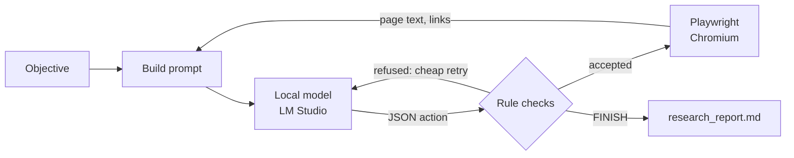

# LocalAgentBrowser

**An autonomous web agent powered by a local LLM. Give it an objective; it searches, reads, takes notes and
decides when it's done, all on your own computer.**

[](https://github.com/SnowFXXX/LocalAgentBrowser/actions/workflows/tests.yml)
[](https://github.com/SnowFXXX/LocalAgentBrowser/blob/main/LICENSE)

-green.svg)

<p align="center">
  
</p>

A local language model served by [LM Studio](https://lmstudio.ai) decides what to do next, and
[Playwright](https://playwright.dev/python/) carries it out in a visible Chromium window you can watch. Built
and tuned to work well with a **small 7B model on a CPU, no GPU required**.

- 🔒 **No cloud AI and no API keys.** The model runs in your own LM Studio.
- 🧭 **Goes from objective to findings unattended.** It searches, opens pages, reads long pages part by part,
  records what's relevant and finishes when the objective is met.
- 🛡️ **Keeps a small model on track.** Rules enforced in code stop loops, repeats and drifting, and the model
  is regularly asked to check its progress against the objective.
- ⚡ **Built for slow hardware.** It reuses LM Studio's prompt cache, so most turns process only what changed.
- 📝 **A readable report every time.** `research_report.md` holds the final result and every finding with its
  source, written however the run ends; `research_log.txt` keeps every action and reason.
- ✅ **Tested.** 165 tests on Linux and Windows, Python 3.10–3.13, run in a few seconds with no model or browser,
  plus a [regression suite](#regression-suite) of live runs on seven different kinds of task.

📖 **The story behind it:** [Teaching a 7B model on a CPU to finish what it starts](https://dev.to/snowfxxx/teaching-a-7b-model-on-a-cpu-to-finish-what-it-starts-1amc),
six lessons from 30 versions of keeping a small local model on track.

## Contents

[Quick start](#quick-start) · [What a run looks like](#what-a-run-looks-like) · [How it works](#how-it-works) ·
[Settings](#settings) · [Performance](#performance) · [FAQ](#faq) · [Limitations](#limitations) ·
[Roadmap](#roadmap) · [Contributing](#contributing)

## Quick start

1. Install [LM Studio](https://lmstudio.ai), download a model (developed with **Qwen2.5-7B-Instruct**),
   load it and start the local server (Developer tab → Start Server).
2. Install the agent from [PyPI](https://pypi.org/project/localagentbrowser/) (Python 3.10 or later, ideally
   in a virtual environment) and the Chromium browser it drives:

   ```bash
   pip install localagentbrowser
   python -m playwright install chromium
   ```

3. Run it and type your objective:

   ```bash
   localagentbrowser
   ```

   It asks for the objective, opens a Chromium window and starts its first turn:

   ```text
   🤖 ==================================================== 🤖
   🚀 Initializing Autonomous Discovery Agent Setup...
   🎯 Define the Agent's High-Level Objective: What is the tallest mountain in Africa, and how tall is it in meters and in feet?

   🧠 [TURN 1/100] Active reasoning cycle executing...
   🔍 Scraping and preparing current environment text layout...
   💡 Agent Thoughts: I need to find out the tallest mountain in Africa and its height in meters and feet.
      I should start by searching for this information.
   🎬 Chosen Action: [SEARCH] -> Parameter: tallest mountain in Africa
   🌐 Driving Playwright to cross-domain target: https://html.duckduckgo.com/html/?q=tallest+mountain+in+Africa
   ```

   Each turn takes from under a minute to a few minutes on a CPU (see [Performance](#performance)); the
   [example run](#what-a-run-looks-like) below shows how it continues.

   When it finishes, read `research_report.md` in the folder you ran it from. Press Ctrl+C at any time to
   stop; the report is still written with everything found so far.

To work on the code instead, clone the repository and install from it:

```bash
git clone https://github.com/SnowFXXX/LocalAgentBrowser.git
cd LocalAgentBrowser
pip install -r requirements.txt
python -m playwright install chromium
python agent_browser.py
```

## What a run looks like

A complete real run with version 1.40, using the [live test runner](#testing) (which adds the timing lines);
repetitive status lines are left out and long lines are wrapped. Objective: *"What is the tallest mountain in
Africa, and how tall is it in meters and in feet?"*

```text
🧠 [TURN 1/100] Active reasoning cycle executing...
   (model call 38.6s, prompt=676 tok, completion=54 tok)
💡 Agent Thoughts: I need to find out the tallest mountain in Africa and its height in meters and feet.
   I should start by searching for this information.
🎬 Chosen Action: [SEARCH] -> Parameter: tallest mountain in Africa

🧠 [TURN 2/100] Active reasoning cycle executing...
⚡ Continuing the conversation (follow-up 1/12, ~1654 tokens)
   (model call 122.8s, prompt=1491 tok, completion=86 tok)
💡 Agent Thoughts: From the search results, I can see that Mount Kilimanjaro is mentioned as the tallest
   mountain in Africa ... I will navigate to one of these pages to find the exact height in meters and feet.
🎬 Chosen Action: [NAVIGATE] -> Parameter: https://en.wikipedia.org/wiki/Mount_Kilimanjaro

🧠 [TURN 3/100] Active reasoning cycle executing...
⚡ Continuing the conversation (follow-up 2/12, ~3693 tokens)
   (model call 347.3s, prompt=3753 tok, completion=84 tok)
💡 Agent Thoughts: The page provides the height of Mount Kilimanjaro in meters and feet. I will extract
   this information to complete the objective.
🎬 Chosen Action: [DISCOVER] -> Parameter: Mount Kilimanjaro is the highest mountain in Africa, with an
   elevation of 5,895 m (19,341 ft) above sea level.

🧠 [TURN 4/100] Active reasoning cycle executing...
⚡ Continuing the conversation (follow-up 3/12, ~3955 tokens)
   (model call 63.9s, prompt=3975 tok, completion=127 tok)
♻️ Cheap retry 1/2: [FINISH] refused. Your only discovery comes from
   https://en.wikipedia.org/wiki/Mount_Kilimanjaro. Consider whether the objective needs more. The current
   page still has 32 unread parts: use its outline to judge whether any of them is relevant before reading
   them. Before finishing, split the OBJECTIVE into its separate parts and, in thought_process, write each
   part followed by the discovery that covers it, or 'not covered'. ...
   (model call 80.6s, prompt=4368 tok, completion=97 tok)
💡 Agent Thoughts: The objective has two parts: the name of the tallest mountain in Africa and its height
   in meters and feet. Both are covered by the discovery from Mount Kilimanjaro's Wikipedia page.
🎬 Chosen Action: [FINISH] -> Parameter: The tallest mountain in Africa is Mount Kilimanjaro, which has an
   elevation of 5,895 meters (19,341 feet) above sea level.
🎯 Agent has signaled mission complete. Writing the final result...
   (model call 52.3s, prompt=312 tok, completion=41 tok)
🔒 Shutting down browser instance. Report: research_report.md; full journal: research_log.txt.
```

Four turns and 11.8 minutes of model time on a CPU: it searched, chose a page, recorded the answer, checked
each part of the question against what it had found before finishing, and then wrote the final result in a
separate step. The `research_report.md` it produced:

> **Status:** finished by the agent on turn 4
>
> **Final result:** The tallest mountain in Africa is Mount Kilimanjaro [1], and its elevation is 5,895 meters
> (19,341 feet) above sea level [1].
>
> **Discoveries (1)**
> 1. Turn 3, from https://en.wikipedia.org/wiki/Mount_Kilimanjaro: *Mount Kilimanjaro is the highest mountain
>    in Africa, with an elevation of 5,895 m (19,341 ft) above sea level.*

### Results on different kinds of tasks

Live runs on the development machine (CPU only, Qwen2.5-7B). Each kind of task is used to find and fix what
does not generalise; the [changelog](https://github.com/SnowFXXX/LocalAgentBrowser/blob/main/CHANGELOG.md) has the details.

| Kind of task | Objective (abridged) | Version | Outcome |
|---|---|---|---|
| Documentation research | Setup commands and file layout for Playwright's test agents | 1.27 | Finished on its own in 13 turns (~36 min) with commands, roles and file layout |
| Documentation research, strict | The same, but "do not FINISH until fully validated", including "parameter schemas" | 1.38–1.40, 1.50 | 1.38–1.40: its most detailed findings (per-client setup, seed test, agent definition files), but it kept searching for schemas the docs do not contain and did not finish within an hour. 1.50: finished in 10 turns (25 min) with the official init command and file layout, but with thin findings and without saying the schemas were not found |
| Opinion from several sources | How spiritual traditions view cats, then form an opinion | 1.30 | Six traditions from two sources and a stated opinion, in 18 turns (37 min of model time) |
| Opinion from several sources | How at least three cultures or religions have viewed owls, then an opinion on why | 1.47–1.48 | Greek, English and many Native American views from one detailed source in 11 turns (38 min); 1.48 adds the opinion the result had left out and catches an invented sentence in a discovery |
| Factual question | Tallest mountain in Africa, height in meters and feet | 1.35, 1.40, 1.46 | Correct, cited answer in 4 turns (about 12 min of model time) in all three versions; before 1.35 it kept reading after finding it |
| Comparison and recommendation | Python vs Rust for command-line tools; recommend one for a beginner. Later: SQLite vs PostgreSQL for a small web app, then a recommendation for a hobby project | 1.36, 1.42, 1.50 | Python vs Rust: cited comparison recommending Python in 16 turns (33 min), Rust's libraries not covered. SQLite vs PostgreSQL: all three parts covered and cited, with a recommendation, in 13 turns (38 min); on 1.50 in 8 turns (25 min) |
| List of items | Three free, open-source Photoshop alternatives and the strengths of each | 1.37–1.38 | GIMP, Krita and Darktable with their strengths, all cited, in 9 turns (24 min); 1.37 listed a fourth and added an unrequested opinion, which 1.38 fixes |
| List of items | Three free, open-source alternatives to Microsoft Office and what each is best at | 1.46, 1.51 | LibreOffice and OnlyOffice with their strengths, cited, in 18 turns (49 min); the third, FreeOffice, is free but not open source, and LibreOffice was recorded four times in different words; on 1.51: LibreOffice, OnlyOffice and Apache OpenOffice, all open source, in 7 turns (16 min) |
| Step-by-step how-to | Make a sourdough starter, with quantities and what to do each day | 1.36–1.37 | A clear plan in 7 turns (19 min), but it invented the first water amount; 1.37 stops guessing and flags unsupported numbers, and the agent then went looking for the missing details |
| Step-by-step how-to | Repot a houseplant: what you need, the steps, and care for the first two weeks | 1.43–1.44, 1.51 | 1.43 recorded six steps it wrote itself before reading the part that had them; 1.44 recorded the guide's real steps but took 68 min and its result left one out. 1.51: every step from the page, in 7 turns (29 min), and it says that no care instructions beyond the first watering were found |
| Explanation of a topic | How photosynthesis works: inputs and outputs, both stages and where each takes place | 1.41–1.42, 1.52 | A complete, cited explanation in 18 turns (45 min); 1.41 read four parts of a relevant page without recording them and had not finished after 49 min. 1.52 recorded both stages and where each takes place, but did not finish within 65 min: it read the history sections of a long encyclopedia article twice and never recorded the inputs and outputs |

### Regression suite

Since 1.53, every change is measured on the same seven objectives, one of each kind above, run one after the other
with a time limit each (`tools/regression.py`, see [Testing](#testing)). Single runs vary with the pages a search
turns up, so the suite compares versions on all seven at once. 1.54 to 1.56 were internal steps measured this way
and released together as 1.57; [docs/regression-history.md](https://github.com/SnowFXXX/LocalAgentBrowser/blob/main/docs/regression-history.md)
has every step's results and what each one showed.

| Task | 1.52 | 1.53 (objective checklist) | 1.57 (coverage check) |
|---|---|---|---|
| Factual question | Finished, 12 min | Finished, 14 min | Finished, 13 min |
| List of three office suites | Time limit | Finished, 30 min; but WPS Office is not open source | Time limit: three correct open-source suites by turn 7, sent back because no words showed them to be "free" |
| Comparison and recommendation | Time limit | Finished, 39 min | Time limit, after a send-back for "official documentation", which the objective does not ask for |
| How-to (cold brew from 1.55; repotting before) | Time limit | Time limit | Finished, 36 min; but "how long it keeps" answered with the steeping time |
| Explanation (photosynthesis) | Time limit | Finished, 13 min, but thin: no oxygen or water | Finished, 59 min: inputs, outputs and both stages, cited |
| Opinion (owls) | Time limit | Finished, 38 min | Time limit: its first page covered two of the three cultures asked for |
| Documentation (venv, official docs) | Finished, 15 min, from a tutorial site | Time limit (30 min) | Finished, 37 min, all from python.org; but the Windows line repeats the create command instead of the activate one |

## How it works

Each turn, the model sees the objective, what it has found so far, a journal of its recent actions and the
current page, and answers with exactly one JSON action:

| Action | What it does |
|---|---|
| `SEARCH` | Searches DuckDuckGo (HTML version) and shows a numbered list of results with their real URLs |
| `NAVIGATE` | Opens a URL taken from the results or from the current page's links |
| `READ_MORE` | Shows the next part of a long page (pages are read in parts of about 2,500 characters) |
| `DISCOVER` | Records information from the current page as a finding |
| `FINISH` | Ends the run (after checking each part of the objective is covered); the final result is then written in a separate step |



### Keeping a small model on track

- **Rules enforced in code, not just stated in the prompt.** Repeated searches, visiting the current page,
  empty or duplicate findings and impossible `READ_MORE` requests are refused, and the model is told why.
  Duplicate findings are recognised even when reworded into different lines, punctuation or order.
- **Cheap retries.** A refused reply is corrected inside the same turn by appending a short note to the
  conversation, instead of wasting a whole turn.
- **Confirm before leaving or reading on.** Leaving a page without recording anything from it triggers one
  check: record something, or repeat the action to leave. Moving on to the next part of a page works the same
  way, and the model must first list what the part it is on says about the objective (or "none").
- **Findings must match the page.** A finding that shares too few word pairs with the page text shown so far
  (or has a sentence that does) is sent back once, asking for only what the page says in its own words, and
  one far from anything on the page is refused outright. A small model will otherwise "complete" a list from
  its own knowledge when a page says "follow these 6 steps" and the steps come later. The refusal points the way:
  it quotes the one page sentence closest to what the model wrote, to record instead, or names what the parts
  shown never mention ("Japan, Navajo"), so the model reads on.
- **An objective checklist.** At the start, one short model call splits the objective into a fixed checklist of
  what the result must contain, keeping conditions like "free, open-source" or "three". Each finding names the
  items it serves, the checklist with its findings is in every prompt, and every check goes through these items
  instead of asking the model to split the objective again from memory, which drifted: it once blocked its own
  finish over "migration strategies", which the objective never asked for. Opinion items are shown as written
  at FINISH, not as gaps to fill, and the first search covers the whole objective in one short query, keeping
  its conditions ("official python documentation venv").
- **A coverage check before finishing.** Each checklist item is checked against the findings in a short call of
  its own, and the code checks the verdict instead of taking it on trust: an item nothing was copied for, fewer
  things than asked for ("only 1 of 3 found"), and things not shown, in words copied from a finding about them,
  to meet a condition such as "open-source". A claim that something is missing is dropped when every word of it is
  already in the findings. With gaps, the FINISH is sent back once, with the next step named ("SEARCH for
  'OnlyOffice free and open-source' to check it, or replace it"), and the next turn starts from a fresh prompt.
- **Numbered findings.** Findings are numbered in the prompt and listed with every check, and the model names
  the finding that covers each part of the objective ("covered by [2]") instead of just saying "covered".
- **Knowing when it's done.** After every new finding the model is asked whether the objective is now fully
  covered, and if so to finish instead of reading on for extra details.
- **Progress and objective checks.** After 4 turns without a new finding, and every 8 turns regardless, the
  model is asked to check each part of the objective against its findings, then finish or name what is still
  missing. Finishing itself gets the same part-by-part check (with the number of sources and any unread parts
  of the current page), and a finish whose own check lists a part as "not covered" is sent back to work on it.
  A part that cannot be found after several tries can be reported as missing instead of blocking for good.
- **Writing is a separate step.** When the agent finishes, one more model call writes the final result from
  only the objective and the recorded findings, under a short list of rules: no guessing or outside knowledge,
  cite findings by number, give as many items as asked for (never repeating one, and saying how many were not
  found), and add a "My view:" paragraph only when the objective asks for an opinion. A small model writes far
  better when that is its only job, and every claim stays traceable to a recorded finding. What no finding
  answers is not left to the model: those checklist items, and things not shown to meet a condition, are left out
  of what it is asked to write, and the code adds them after the result as "Not found in the pages read" and
  "Left out, not shown to meet the conditions". The report flags any number in the final result that appears in
  none of the findings, the most harmful kind of slip in a how-to.
- **Error pages are recognised.** A page answering 404, 403 and so on counts as a failed visit, not content.
- **Readable pages.** Navigation menus, footers, cookie banners and site notices such as fundraising banners are
  hidden; code blocks and tables are
  never split between parts; links already shown are not repeated. Long pages come with an outline of the
  headings in each part, marking the parts already read, so the agent can jump to the part it needs instead of
  reading in order.

### Built for slow hardware

On a CPU, reading the prompt is about 90% of the time of every model call, and LM Studio can skip whatever
part of a prompt matches the start of its previous one. So the agent keeps one growing conversation and only
appends what changed (a short result, the next page part or a new page), building a fresh prompt only when
the conversation nears the context limit. The journal uses a compact one-line-per-entry format.

## Settings

| Environment variable | Default | Meaning |
|---|---|---|
| `LMSTUDIO_BASE_URL` | `http://localhost:1234/v1` | Address of the OpenAI-compatible server |
| `LMSTUDIO_MODEL` | `qwen2.5-7b-instruct` | Model identifier as the server lists it |
| `LMSTUDIO_API_KEY` | `lm-studio` | API key, if your server requires one |
| `LMSTUDIO_CONTEXT_LENGTH` | `8192` | Context length the model is loaded with; the conversation budget follows it |

Behaviour limits (part size, retry counts, check intervals and so on) are named constants at the top of
`agent_browser.py`, each with a comment explaining it.

## Performance

Measured on an Intel i5-9500 (6 cores, no GPU) with Qwen2.5-7B-Instruct Q4_K_M at an 8,192-token context:

| Kind of turn | Typical time |
|---|---|
| Follow-up on the same page (finding recorded, cheap retry) | 35–60 s |
| Next part of a page, or a new page appended | 100–280 s |
| First turn of a run | 45–110 s |
| Fresh prompt (context budget reached, or after a coverage send-back) | 160–540 s (longest with long pages) |
| Coverage check before finishing (all checklist items) | about 1–3 min |
| Writing the final result (once, at the end) | 50–190 s, depending on how much was found |

Whole runs vary with the pages a search turns up. In the regression runs since 1.53, a factual question took 13 to
19 minutes of model time; the list, comparison, how-to, opinion and documentation tasks 21 to 44 when they finished;
and the explanation 13 to 59. A GPU or a smaller model will be much faster.

## FAQ

**Does it need a GPU?**
No. It was developed entirely on a CPU. A GPU just makes each turn faster.

**Which models work?**
It was developed and tested with Qwen2.5-7B-Instruct (Q4_K_M). Any instruction-tuned model that LM Studio
serves should work, as long as the server supports `response_format` with a JSON schema (LM Studio 0.3 and
later). Set `LMSTUDIO_MODEL` and `LMSTUDIO_CONTEXT_LENGTH` to match. Reports with other models are very welcome.

**Can I use another OpenAI-compatible server instead of LM Studio?**
Probably: point `LMSTUDIO_BASE_URL` at it. It has only been tested with LM Studio, and the speed tricks rely
on the server reusing cached prompt prefixes (llama.cpp-based servers do).

**Is anything sent to the internet?**
No AI service is involved, and nothing about your run is uploaded. The agent does browse the real web,
though: search queries go to DuckDuckGo, and pages it opens load normally, as if you visited them yourself.

**Where are the results?**
In the folder you ran it from: `research_report.md` has the final result and every finding with its source,
and `research_log.txt` has the full journal of actions and reasons, updated after every turn.

**Why does a turn take minutes?**
On a CPU the model reads the prompt slowly (about 8 tokens per second on the development machine), so a
turn that brings in a new page takes a few minutes. See [Performance](#performance) and
[Built for slow hardware](#built-for-slow-hardware).

## Limitations

- **Tried on seven kinds of task so far** (see [results](#results-on-different-kinds-of-tasks)): documentation
  research, an opinion from several sources, a factual question, a comparison, a how-to, a list and an
  explanation of a topic. Each one
  exposed something that did not generalise and was fixed; other kinds of tasks may expose more.
- **Judging whether a finding covers an item is the weakest area.** The model's verdict is unreliable both ways:
  on 1.53 the explanation finished from one overview paragraph without oxygen or water, and in the regression runs
  since 1.54 about half of the coverage check's send-backs were for gaps that were not real ("missing official
  documentation" on a comparison that did not ask for it, "H2O, O2" already recorded). The code now verifies what
  it can (an item nothing answers, a count, word-for-word proof of a condition), but each wrong send-back still
  costs a finish on this hardware, since a send-back costs 8–10 minutes.
- **Conditions in the objective.** A small model tends to drop conditions such as "open source" or "using the
  official documentation": a list of open-source office suites once included FreeOffice (free but not open
  source), and a task that asked for the official Python documentation used a tutorial site. The objective
  checklist keeps the conditions in view (the documentation task uses python.org since 1.55), and a thing not
  shown in the findings to meet a condition is left out of the result and listed after it. The check is strict:
  on 1.57 it sent back three correct open-source suites because no words showed them to be "free". Check the
  result against any conditions you set.
- **A small model's judgement is the ceiling.** It sometimes drifts to loosely related pages, prefers
  secondary sources or stays with one source too long, and results vary with the first pages a search turns
  up; every finding is in `research_report.md` regardless.
- **Very strict objectives.** An objective that forbids finishing until everything is "fully validated" used
  to keep the agent looking for something the web may not contain. On 1.50 it finished such an objective in 25
  minutes, but with thin findings and without naming what it could not find, so check the result against the
  objective.
- **Check the citations.** The final result is told to use only recorded findings, but a 7B model sometimes
  puts the wrong number on a citation, adds a line no finding supports, leaves out a step or misreads a part of
  the question (on 1.57 it answered "how long it keeps in the fridge" with the steeping time), so verify a claim
  against the listed findings before relying on it.
- **Some sites refuse automated browsers** (HTTP 403). The agent respects that and does not try to disguise
  itself; it moves on to other sources.
- **Reading only.** The agent searches, opens pages and reads them. It does not click, fill in forms or sign in.
- **Web pages go into the prompt.** A page can contain text written to manipulate the model (prompt
  injection), so treat findings as unverified. See [SECURITY.md](https://github.com/SnowFXXX/LocalAgentBrowser/blob/main/SECURITY.md).
- **One search provider.** DuckDuckGo's HTML search occasionally returns an error page; the agent retries once.

## Roadmap

- [x] Include every finding in the final report, not only the model's own summary (1.29)
- [x] Write the final result in a separate, rule-bound step and flag unsupported numbers (1.32–1.38)
- [x] Finish as soon as the objective is covered (1.35)
- [x] Get the model to weigh each part of a long page before reading on (1.42)
- [ ] Let very strict objectives end with the gaps named instead of searching indefinitely (they finish since 1.50; naming the gaps is still open)
- [x] Measure every change on a regression suite of seven kinds of task (1.53)
- [x] Keep a fixed checklist of the objective's parts instead of re-splitting it at every check (1.53)
- [ ] Check that a finding really covers its checklist item, including conditions like "open source" (partly, since
  1.57: a coverage check before finishing, with what the code can verify)
- [ ] Send the agent back only for gaps the code verifies, and let the model's other verdicts only shape the final
  result (the next step after 1.57)
- [ ] Rewind dead ends: save the conversation before an expensive step such as reading a long page, and if it
  leads nowhere, return to that point with a short note instead of carrying the unused page text in every later
  prompt (LM Studio reuses its cache up to the saved point)
- [ ] Try more kinds of objectives (seven so far) and adjust the rules that don't generalise
- [ ] Make fresh prompts (the slowest kind of turn) cheaper still (31% cheaper since 1.34)
- [ ] Interacting with pages (clicking, forms) for tasks beyond reading

Ideas and requests are welcome in [issues](https://github.com/SnowFXXX/LocalAgentBrowser/issues).

## Testing

The test suite runs in a few seconds and needs neither LM Studio nor a browser: the model and the website
are replaced by scripted fakes, including an end-to-end run of the main loop.

```bash
pip install -r requirements-dev.txt
python -m pytest
python -m ruff check .
```

To try the real agent with a fixed objective and a time limit, logging the time and tokens of every model
call:

```bash
python tools/live_test.py "Your objective here" --minutes 25
```

To measure a change on all seven kinds of task (about four hours on a CPU), compared with an earlier run:

```bash
python tools/regression.py --baseline regression_runs/<earlier run>/summary.json
```

Each run gets a folder in `regression_runs/` with every task's report, journal, console output and prompt
trace, and a `summary.md` that is updated after each task: whether it finished, turns, model time, how many
checklist items got findings, which checks fired, and problems found by simple word checks (missing answers,
missed conditions such as a non-open-source item, uncited paragraphs, numbers missing from the findings, a
missing opinion). It also flags a task that fails again on the same site as in the earlier run: one site that
cannot answer part of an objective can decide a task whatever the agent does (the repotting how-to went to the same
guide in three runs, which is why the core how-to is now the cold brew one). `--suite all` adds six more tasks,
including the earlier how-to, `--only` runs some of them, and `--rescore` scores an earlier run again without the
model. Every step since 1.53 and its results are in
[docs/regression-history.md](https://github.com/SnowFXXX/LocalAgentBrowser/blob/main/docs/regression-history.md).

## Contributing

Contributions are welcome! See [CONTRIBUTING.md](https://github.com/SnowFXXX/LocalAgentBrowser/blob/main/CONTRIBUTING.md) for setup and guidelines, and please follow
the [Code of Conduct](https://github.com/SnowFXXX/LocalAgentBrowser/blob/main/CODE_OF_CONDUCT.md). Security issues: see [SECURITY.md](https://github.com/SnowFXXX/LocalAgentBrowser/blob/main/SECURITY.md).

## Project history

Every released version is a tagged commit, and [CHANGELOG.md](https://github.com/SnowFXXX/LocalAgentBrowser/blob/main/CHANGELOG.md) describes what changed in each one and
why, with the measurements behind the decisions. Versions 1.54 to 1.56 were internal steps, each measured on the
regression suite and released together as 1.57; their results are in
[docs/regression-history.md](https://github.com/SnowFXXX/LocalAgentBrowser/blob/main/docs/regression-history.md).

## Acknowledgements

Versions 1.13 onwards were developed together with [Claude](https://www.anthropic.com/claude) (Anthropic),
working in Claude Code; those commits list Claude as co-author. Built on [LM Studio](https://lmstudio.ai),
[Playwright](https://playwright.dev/python/) and the [OpenAI Python library](https://github.com/openai/openai-python).

## License

[MIT](https://github.com/SnowFXXX/LocalAgentBrowser/blob/main/LICENSE) © 2026 SnowFX
