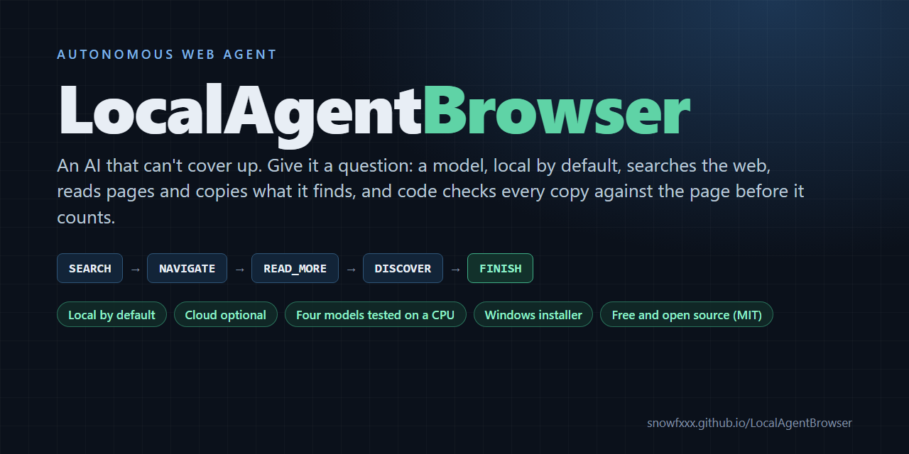
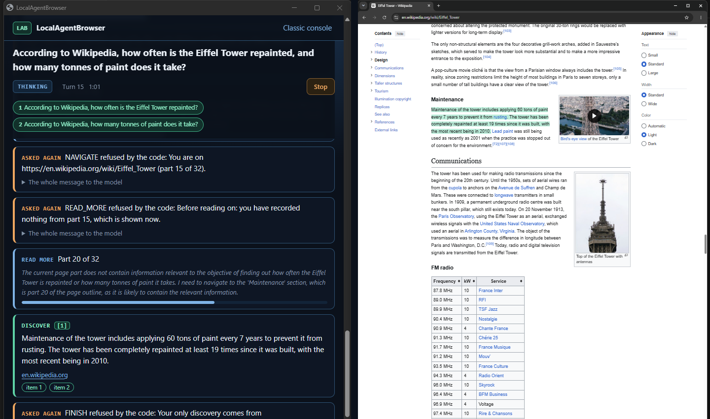
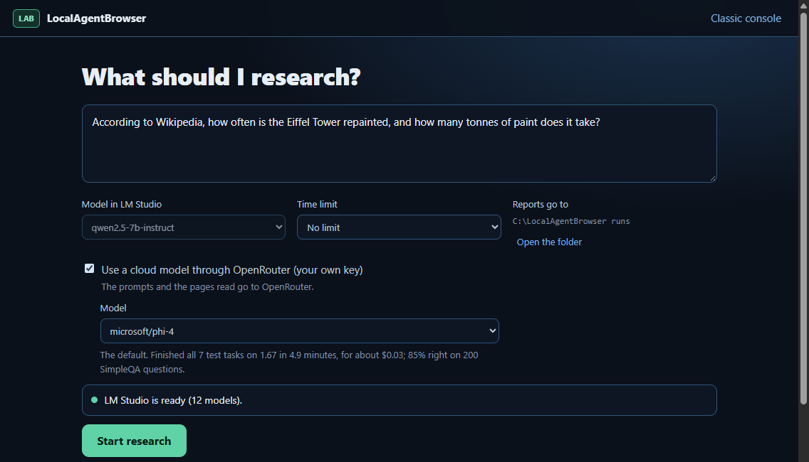
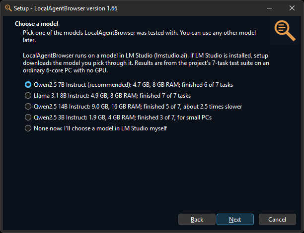
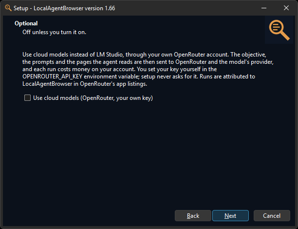
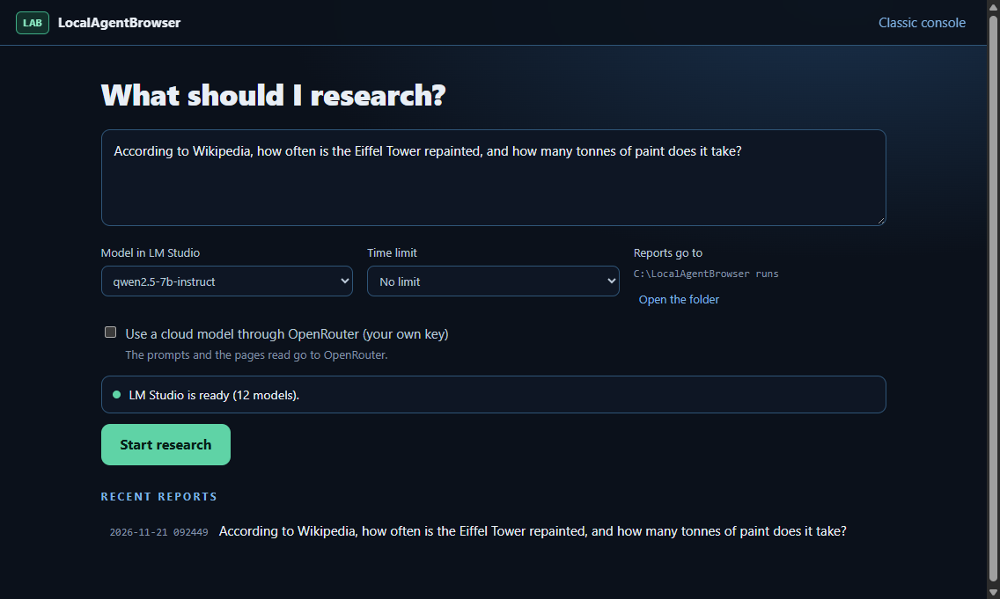
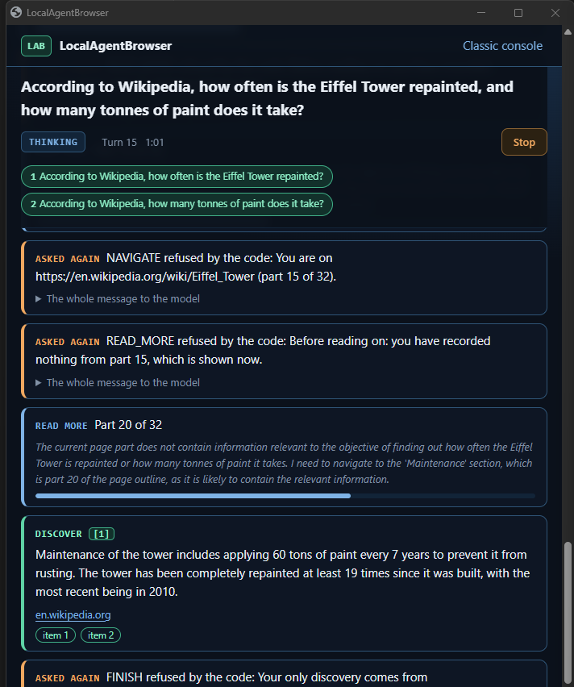
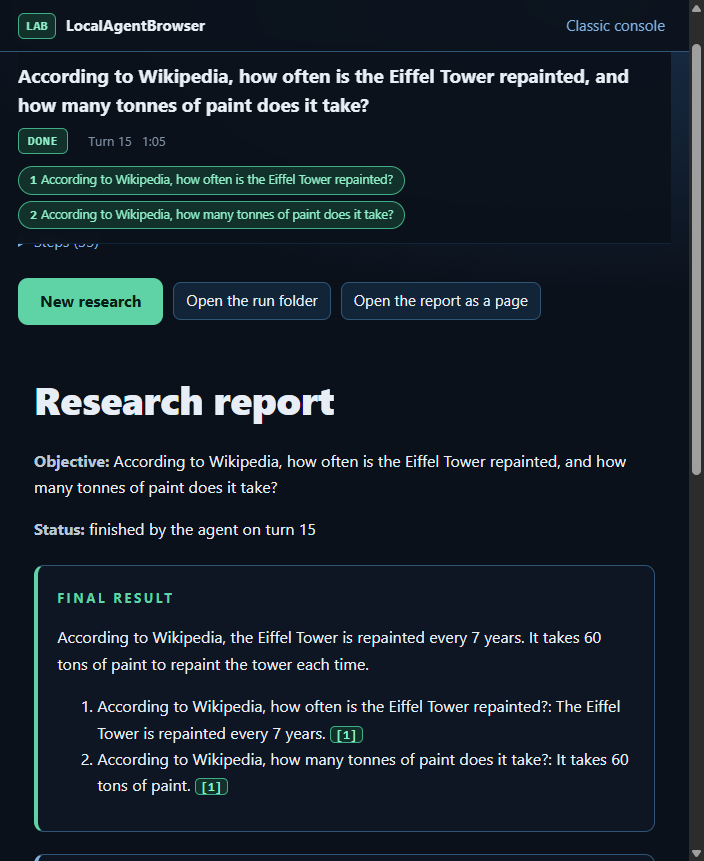
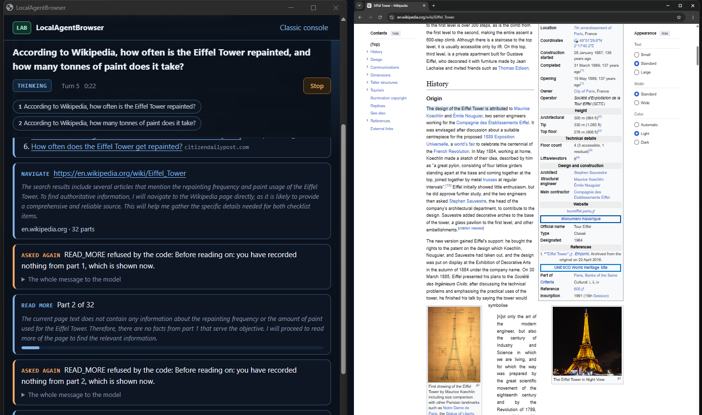
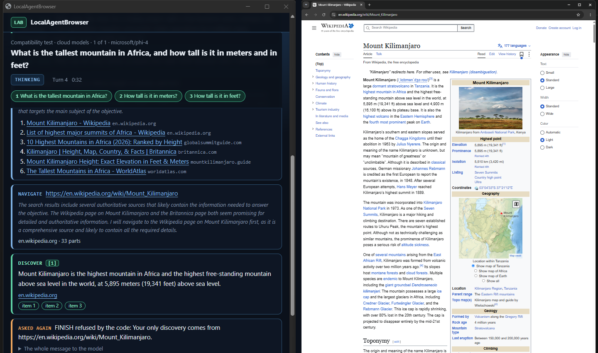

# LocalAgentBrowser

**An autonomous web agent powered by a local LLM. Give it an objective; it searches, reads, takes notes and
decides when it's done, on your own computer, with a local model or, if you choose, a cloud one. It gives an answer
you can check, or says honestly what it couldn't find.**

**L.A.B.** for short, and it wears a LAB COAT: **Citations Over Assumed Truth.** Every claim in an answer points to the
page it came from, and code checks it is there, because the project's principle is **Verification Over Trust**.

**New in 1.68: [a window of its own](#first-run) on Windows.** Type your question on a start screen, then watch the
agent work in a live view beside its browser. The browser scrolls to the part being read and marks each finding.
The report appears in the same window, and the classic console is one click away. Also new: a
[compatibility test](#compatible-models) that has tried 79 cloud models and 18 local ones, and a menu of cloud
models with our recommendations. **In 1.67:** [Clean Room](#clean-room-a-private-edition), a private edition with
the cloud code removed before it is built. **In 1.66:** sturdier cloud runs and more of every answer checked in code.
**In 1.65:** a [Windows installer](#windows-the-installer-recommended) with a choice of tested models, and optional
cloud models through [OpenRouter](https://openrouter.ai) for fast answers.

[](https://github.com/SnowFXXX/LocalAgentBrowser/actions/workflows/tests.yml)
[](https://pypi.org/project/localagentbrowser/)
[](https://github.com/SnowFXXX/LocalAgentBrowser/blob/main/LICENSE)


[](#clean-room-a-private-edition)

<p align="center">
  
</p>

A language model decides what to do next, and [Playwright](https://playwright.dev/python/) carries it out in a
Chromium window you can watch. By default the model runs in [LM Studio](https://lmstudio.ai) on your own computer,
and the agent is built to work even with a **small model on an ordinary CPU, no GPU required**; if you want speed, it
can use a cloud model instead. Every claim in its answer points to the page it came from.

<p align="center">
  
</p>
<p align="center"><sub>1.68 on Windows: the window follows the run on the left; the agent's browser marks what it recorded, in mint, on the right. The amber cards are the checks at work.</sub></p>

- 🔒 **Local by default, cloud if you choose.** By default the model runs in your own LM Studio, with no API key, and
  your objective and report stay on your computer (searches go to DuckDuckGo and pages load like in any browser).
  Cloud models through OpenRouter are an option you turn on yourself, with your own key: much faster, but your
  prompts and the pages read leave your computer. Or choose [Clean Room](#clean-room-a-private-edition), the private
  edition, which has no cloud option at all (see [Two editions](#two-editions)).
- ✅ **Checks instead of trust.** Findings must be copied from the page shown, commands must appear on the page
  exactly, and numbers no finding gives are cut. What it can't find is listed as not found, not filled in.
- 🧭 **Unattended.** It searches, opens pages, reads long pages part by part, records what's relevant and finishes
  when every part of the objective is covered.
- 📝 **A report every time.** The final result with numbered citations and every finding with its source, written
  however the run ends.
- 🪟 **Easy on Windows.** An installer with its own Python and a choice of tested models, and a window of its own: a
  start screen, a live view beside the agent's browser, the report in place, and a tray icon for new research and
  recent reports.

📖 [Project site](https://snowfxxx.github.io/LocalAgentBrowser/) ·
[Article: We Can Do Better: A Small AI That Can't Cover Up](https://snowfxxx.github.io/LocalAgentBrowser/article.html) ·
[Paper: Verification over Trust](https://snowfxxx.github.io/LocalAgentBrowser/paper.html) ·
[Example reports](https://github.com/SnowFXXX/LocalAgentBrowser/blob/main/docs/examples/README.md)

## Contents

[Two editions](#two-editions) · [Tested on four models](#tested-on-four-models) · [Compatible models](#compatible-models) ·
[Install](#install) · [First run](#first-run) ·
[What a run looks like](#what-a-run-looks-like) · [How it works](#how-it-works) · [Settings](#settings) ·
[FAQ](#faq) · [Limitations](#limitations) · [Roadmap](#roadmap) · [Testing](#testing) · [Contributing](#contributing)

## Two editions

LocalAgentBrowser comes in two editions, built from the same code and released together. Both run the same agent
with the same checks: every finding copied from the page it came from, every claim cited, and what wasn't found
reported as not found.

| | **Standard edition** | **Clean Room, a private edition** |
|---|---|---|
| Model | LM Studio on your PC by default; cloud models through OpenRouter if you turn them on | LM Studio on your PC or your local network, only |
| Cloud option | Off unless you turn it on, with your own key | Not there: removed before the edition is built |
| Speed | Your hardware's, or a few minutes a run in the cloud | Your hardware's |
| Cost | Free locally; cents a run in the cloud | Free |
| What leaves your computer | Searches and page visits; with cloud models on, your prompts and the pages read too | Searches and page visits |
| Windows installer | `LocalAgentBrowser-<version>-setup.exe` | `LocalAgentBrowser-CleanRoom-<version>-setup.exe` |
| pip | `pip install localagentbrowser` | `pip install localagentbrowser-cleanroom` |
| Best for | Everyday research, quick answers when time matters, comparing models | Sensitive topics, strict data policies, shared PCs |

Both install side by side on Windows, each with its own folder and shortcuts, and both block the browser's own
calls to Google (account checks, push-message check-ins, component updates and autofill lookups).

### Standard edition: local models, with optional cloud models

The full LocalAgentBrowser. It runs on a model in LM Studio on your own computer, and when you want speed it can use
a cloud model through your own OpenRouter account instead.

**Local models, by default**

- **No GPU, no API key, no account.** Built and tested on an ordinary 6-core CPU with small models; the installer
  offers the four [tested models](#tested-on-four-models) and downloads the one you pick through LM Studio.
- **Free to run, as often as you like.** A run takes about 10 to 60 minutes on a CPU, so start it and let it work.
- **Your objective and report stay on your computer.** Only the searches and page visits go out, as when you browse.

**Cloud models, if you turn them on**

- **Answers in minutes.** The whole seven-task suite took 4 to 24 minutes on cloud models, against hours on a CPU.
- **Cents, not dollars.** $0.04 to $0.14 for the whole suite on 1.66; Phi-4, the cloud default, answered 170 of the
  standard 200 [SimpleQA](#tested-on-four-models) questions (85%) for $0.58.
- **Bigger models without the hardware.** Any model OpenRouter lists, with the same checks holding it to the pages.
- **Your key, your account, your choice.** Off unless you tick it in setup; you set the key yourself and setup never
  asks for it. The agent asks providers not to store or train on your prompts. With cloud models on, your prompts and
  the pages read go to OpenRouter and the model's provider.

**Use it for**

- Everyday research on your own PC: facts, lists with conditions, comparisons, how-tos, explanations.
- Quick answers when you can't wait an hour: turn on cloud models for the day.
- Trying models: the same tasks on a local model and a cloud one, side by side; the test suite runs either.
- Developers and researchers measuring how small models behave as agents.

### Clean Room, a private edition

LocalAgentBrowser with the cloud option taken out. Not switched off: the cloud code is removed before the edition is
built, and the build reads every file and fails if any of it is left. The whole test suite runs on the stripped
copy, so Clean Room is tested on every change, the same as the standard edition.

**What makes it private**

- **No cloud code at all.** No OpenRouter settings, no keys, no cloud option in setup, and nothing in the program
  that could send your prompts to an online AI service. There is nothing to switch on by mistake.
- **Your model, your network.** It only uses a model server on your own PC or your local network (a home or office
  address), whatever `LMSTUDIO_BASE_URL` says. Point it anywhere else and it refuses to start.
- **The browser keeps to itself.** Chromium's own calls to Google are blocked, as in the standard edition.
- **Its own install.** Its own folder, shortcuts and uninstaller, beside the standard edition if you have both, and
  its own short README that says exactly what it connects to.
- **Easy to audit.** The editions differ only in marked lines of code, and `tools/clean_room.py` shows exactly what
  is removed.

**What it connects to:** LM Studio (on this PC or your network), the search engine (DuckDuckGo) and the pages the agent
reads. During setup only, the Chromium download and the model you pick. Nothing else.

**Use it for**

- **Sensitive research:** health, legal and money questions, family matters, anything you'd rather no AI company
  saw.
- **Work under a data policy:** client work, confidential projects, or an employer that doesn't allow sending data
  to AI services.
- **Shared and managed PCs:** schools, libraries, offices and family computers, where nobody should be able to turn
  on a paid cloud option.
- **A GPU box on your network:** run LM Studio on your most powerful machine and Clean Room on any PC in the house
  or office.
- **Peace of mind:** for anyone who wants a research agent that can't send their work to the cloud, by design.

**What it isn't:** anonymous browsing. Searches still go to DuckDuckGo and pages are fetched from the web, so those
sites see a visit from your connection, as they would if you browsed yourself. And it runs at your own hardware's
speed.

**Get it:** **[`LocalAgentBrowser-CleanRoom-1.67.2-setup.exe`](https://github.com/SnowFXXX/LocalAgentBrowser/releases/download/v1.67.2/LocalAgentBrowser-CleanRoom-1.67.2-setup.exe)**, or from the
[latest release](https://github.com/SnowFXXX/LocalAgentBrowser/releases/latest) (see
[the installer](#windows-the-installer-recommended); the steps are the same, without the cloud page), or
`pip install localagentbrowser-cleanroom` (install one edition or the other in a given environment, not both).

## Tested on four models

Releases that change how the agent works are measured on the same seven tasks, one of each kind it's built for: a
fact, a list with conditions, a comparison with a recommendation, a how-to, an explanation, views from several
sources, and a lookup in official documentation. In 1.64, four local models ran them with identical code, 90 minutes
per task, on an ordinary 6-core PC with no GPU (Intel i5-9500). 1.66 and 1.67 change the agent for every model, local
ones included: the default 7B ran the suite again on 1.67, and the other three local results are 1.64's:

| Model (Q4_K_M) | Download | RAM | Tasks finished | Model time | Gaps filled from its own knowledge |
|---|---|---|---|---|---|
| **Qwen2.5-7B-Instruct** (default), on 1.67 | 4.7 GB | 8 GB | **7 of 7** | 291 min | 0 |
| **Llama-3.1-8B-Instruct** | 4.9 GB | 8 GB | **7 of 7** | 303 min | 0 |
| **Qwen2.5-14B-Instruct** | 9.0 GB | 16 GB | 5 of 7 | 565 min | 0 |
| **Qwen2.5-3B-Instruct** | 1.9 GB | 4 GB | 3 of 7 | 490 min | 0 |

- **No finished result filled a gap from the model's own knowledge**, on any model.
- **Llama finished every task.** Read by hand, its results contain no invented facts; its mistakes lean cautious
  (a "not found" for something its findings do give).
- **The 14B** is about 2.5 times slower on a CPU; its two time-outs came while a correct answer was being checked.
- **The 3B** fits small PCs. It finished 3 tasks (none on 1.63), and one of them has a claim the checks missed.
- On 1.63 the same models finished 6, 2, 2 and 0 of 7. Every step and run is in the
  [regression history](https://github.com/SnowFXXX/LocalAgentBrowser/blob/main/docs/regression-history.md).

**The 7B on 1.67 finished all seven tasks** (November 18, 2026, 90 minutes per task as before), in 291 model minutes
against 361 on 1.64, which finished 6. No finished result filled a gap from its own knowledge. Read by hand, three
results have mistakes no check caught: the documentation answer puts the create command under "activate on Windows";
the comparison recommends PostgreSQL for a small hobby project, though its own first finding favours SQLite; and the
opinion answer draws on one website, which its report says. An earlier 1.67 run, started by mistake with the suite's
shorter built-in limits, isn't counted.

**Cloud models** run the same code much faster, through your own OpenRouter account. On 1.67 the suite ran once on
each of four cloud models (November 17, 2026), one model at a time; every one finished all seven tasks, and no
finished result filled a gap from the model's own knowledge, by the suite's measures:

| Cloud model | Tasks finished | Model time | Uncited lines (1.66 → 1.67) | Expected words missing (1.66 → 1.67) | Cost of the suite |
|---|---|---|---|---|---|
| `microsoft/phi-4` (the cloud default) | 7 of 7 | 4.9 min | 1 → 3 | 0 → 0 | about $0.03 |
| `openai/gpt-4o-mini` | 7 of 7 | 5.6 min | 1 → 1 | 0 → 1 | about $0.10 |
| `meta-llama/llama-3.1-8b-instruct` | 7 of 7 | 3.0 min | 3 → **1** | 1 → 3 | about $0.01 |
| `google/gemma-3-4b-it` | 7 of 7 | 6.8 min (23.6 on 1.66) | 5 → **2** | 3 → 3 | about $0.02 |
| `anthropic/claude-opus-5.5` | 7 of 7 | 22.6 min | 3 | 0 | $5.47 |

The four smaller models cost $0.23 together (per-model costs are estimated from their token counts). Opus 5.5 ran
once on the 1.67 code before its last two output fixes. It gave the most thorough answers of any model, with about one
citation every 16 words, and labelled its own weakest source ("from reader comments only, not authoritative"). The
same checks held every model to the pages, from a 4B model to Opus.

One run each, scored by the suite's word checks, and read by hand. What the checks didn't catch:
- **Gemma** wrote the same sentence under three parts of the explanation, and its cold brew has no real steps.
- **Llama**'s cold brew has no steps, though no line says they weren't found, and its explanation lists carbon dioxide
  as an output.
- **GPT-4o-mini** repeated a stale page's claim that SQLite lacks triggers and check constraints.
- **Phi-4** named PhotoCraft, an early-stage editor, as the third Photoshop alternative.

Measured earlier on 1.65.1: Gemini 3.8 Flash 7 of 7 (6.1 min, 0 uncited lines, $0.24), GPT-5.6 Terra 7 of 7 (4.9
min, 2 uncited, $0.47), Qwen 2.5 72B 7 of 7 (on 1.65, 13.4 min, 17 uncited, $0.14).

**Fifty SimpleQA questions** (a public benchmark of short, hard facts) on Phi-4, the same 50 each time: alone, with
no browsing, it answered 1 correctly; with LocalAgentBrowser 1.65.1, 38 and 39; with 1.66, **45 (90%)**, 4 wrong and
1 not answered, in 28.6 minutes, for $0.13. Graded by Claude against SimpleQA's reference answers, judgement calls
reviewed by the author. Every question, answer, source and grade is in
[benchmarks/simpleqa](https://github.com/SnowFXXX/LocalAgentBrowser/blob/main/benchmarks/simpleqa/README.md), along with a local run on a CPU (Qwen2.5-7B on 1.64: 35 of 50).

**200 SimpleQA questions,** the standard subset OpenAI's simple-evals runs with `--examples 200`, on 1.66 with
Phi-4 (November 16, 2026): **170 correct (85%; likely range 79 to 89%)**, 11 wrong, 19 not attempted, F-score 0.892, in 142 minutes for
$0.58. When it answered, it was right 94% of the time. 19 times it said it couldn't verify an answer rather than
guess; 11 answers were wrong. OpenAI's own grader (GPT-4.1, simple-evals' prompt) counts 171 correct and gives the same grade on 194 of
the 200. Every answer, its sources and both grades are also a Hugging Face dataset:
[SnowFX/localagentbrowser-simpleqa](https://huggingface.co/datasets/SnowFX/localagentbrowser-simpleqa).

Phi-4 is the cloud default for its clean results; 1.65 named `qwen/qwen-2.5-7b-instruct`, which no OpenRouter
provider serves now.

**Which to pick:** the 7B for most PCs, Llama if you have the same 8 GB and want it to finish more often, the 3B for
a PC with little memory. Any instruction-tuned model LM Studio serves should work.

## Compatible models

The suite above measures a few models closely. The **compatibility test** (`tools/compat.py`, new in 1.68) asks a
simpler question of many: does a model work with the agent at all? It makes about ten model calls on a fixed page
(split the question, choose an action on search results, record a finding that passes the grounding check, check
coverage, write a cited result, write a view, retry a reply cut off at its limit), then runs one live task with the
browser, the suite's factual question. A model is **compatible** when every check passes and the live task ends with
a cited result of its own; **compatible, with limits** when the live task passes but a quick check failed (named in
the table); **did not finish in N minutes** when the live task's time limit stopped it with no other failure (too
slow on that computer, which says nothing about the model working with the agent; the limit is 90 minutes in LM
Studio and 30 in the cloud); and **not compatible** on an error, a reply with no valid JSON, no result, a refused
retry, or a failed live task.

Tested on the pre-release 1.68 code, November 20 and 21, 2026:

- **79 cloud models on OpenRouter:** 61 compatible, 14 compatible with limits, 1 not compatible (Command R7B,
  which finished from what it had read without recording it), and 3 not settled because their providers failed the
  calls. The 79 tests cost $3.70 together. The window's cloud model menu lists the 61, with our recommendations first:

  
- **18 local models in LM Studio, on the same CPU as the suite:** <!-- local results to add when the run ends -->

<details>
<summary>All 79 cloud models</summary>

<!-- cloud table: drafts/compat_section.py, regenerated after the retest -->

</details>

A model that fails here may still be fine for other work; a model that passes is a good start, not a guarantee. Any
model can be tried: `python tools/compat.py MODEL` for one in LM Studio, or `--cloud` for OpenRouter (see
[Testing](#testing)).

## Install

### Windows: the installer (recommended)

1. Install [LM Studio](https://lmstudio.ai) (free). You don't need to download a model in it yet. (Not needed if
   you'll only use cloud models.)
2. Download **[`LocalAgentBrowser-1.67.2-setup.exe`](https://github.com/SnowFXXX/LocalAgentBrowser/releases/download/v1.67.2/LocalAgentBrowser-1.67.2-setup.exe)** and run it (all downloads and release notes:
   [the latest release](https://github.com/SnowFXXX/LocalAgentBrowser/releases/latest)).
   - Windows may say **"Windows protected your PC"**, because the installer isn't code-signed yet. Click
     **More info → Run anyway**.
   - It installs for your Windows account only, with no administrator rights, and brings its own Python.
3. Setup asks what to install (LocalAgentBrowser, and optionally the test suite), which of the five tested models to
   download through LM Studio, and whether to use cloud models (off unless you tick it). It then downloads the
   Chromium browser the agent uses (about 150 MB, once).
4. Open **LocalAgentBrowser** from the Start menu or the desktop: it opens in a window of its own (see
   [First run](#first-run)). If you turned on cloud models, setup also adds **LocalAgentBrowser (cloud)**, which opens
   with the cloud model ticked. Nothing goes to OpenRouter unless that box is ticked, and the tick is never kept from
   one window to the next. **LocalAgentBrowser (classic console)** in the Start menu opens the console instead.

<p align="center">
  
  
</p>

To remove it: **Start menu → LocalAgentBrowser → Uninstall LocalAgentBrowser**, or Windows Settings → Apps. Your
reports in Documents are kept.

### Windows: the Clean Room installer

For [Clean Room, a private edition](#clean-room-a-private-edition), download
**[`LocalAgentBrowser-CleanRoom-1.67.2-setup.exe`](https://github.com/SnowFXXX/LocalAgentBrowser/releases/download/v1.67.2/LocalAgentBrowser-CleanRoom-1.67.2-setup.exe)** (or from the
[latest release](https://github.com/SnowFXXX/LocalAgentBrowser/releases/latest)) and follow the steps above: setup is
the same, without the cloud page. It installs beside the standard edition, with its own folder and shortcuts, and opens
as **LocalAgentBrowser Clean Room**. With pip: `pip install localagentbrowser-cleanroom`.

### Any system: pip

You need Python 3.10 or later, and [LM Studio](https://lmstudio.ai) (free) to run the model, unless you use cloud
models.

```bash
python -m venv venv
venv\Scripts\activate
pip install localagentbrowser
python -m playwright install chromium
```

On macOS or Linux, activate with `source venv/bin/activate` instead.

### From source

```bash
git clone https://github.com/SnowFXXX/LocalAgentBrowser.git
cd LocalAgentBrowser
python -m venv venv
venv\Scripts\activate
pip install -r requirements.txt
python -m playwright install chromium
```

Run it with `python agent_browser.py`.

### Windows shortcuts from a clone

The installer adds these for you. From a clone (above), with its packages installed in a `venv` folder inside it:

```bash
powershell -ExecutionPolicy Bypass -File tools\windows\make_shortcuts.ps1
```

This adds **LocalAgentBrowser** to the Start menu and the desktop. The launcher checks that LM Studio is answering
(or, with cloud models on, that your key is set),
runs each objective in its own folder under **Documents\LocalAgentBrowser runs**, and opens the report as a page in
your browser when the run ends.

## First run

1. In LM Studio, load your model with a **context length of 8192** (the agent's default; LM Studio's own default may
   differ) and start the local server (Developer tab → Start Server). With cloud models turned on, skip this step and
   set your OpenRouter key in the `OPENROUTER_API_KEY` environment variable instead (without the installer, see
   the [FAQ](#faq) for the other settings).
2. Start LocalAgentBrowser: the Start-menu shortcut on Windows (**LocalAgentBrowser (cloud)** for cloud models), or
   `localagentbrowser` in a terminal on other systems.
3. **On Windows, a window opens on a start screen.** Type your objective, for example *What is the tallest mountain
   in Africa, and how tall is it in meters and in feet?* Check the model: LM Studio's list, or, with the cloud box
   ticked, a menu of cloud models with our recommendations first (see [Compatible models](#compatible-models)). Then
   click **Start research**.
4. **The window moves to the left and the agent's browser opens on the right.** The live view shows the parts of
   the objective as chips that light up as each is answered, a card for each action (searches, pages, findings, and
   the checks' refusals), and a timer while the model thinks. The first step takes a minute or two on a CPU. In the
   browser, the page scrolls to the part being read and marks each finding in mint, so you can see where every claim
   comes from (`LAB_FOLLOW=0` turns this off). **Stop** ends a run at any time.
5. **When it finishes, the report appears in the same window**, with buttons to open it as a page or open its
   folder. **New research** starts another. The start screen lists recent reports, and each run gets its own folder
   under **Documents\LocalAgentBrowser runs**. Minimized, the window goes to the notification area; its icon's menu
   has New research, Recent reports, Stop the run and Quit.

<p align="center">
  
  
  
</p>
<p align="center"><sub>Ask, watch it work, read the report: 1.68's window, here on a cloud model.</sub></p>

<p align="center">
  
</p>
<p align="center"><sub>On READ_MORE the browser jumps to the part now read and tints its first words. In amber, the checks: each card gives the reason, and the whole message to the model is one click away.</sub></p>

**The classic console** is one click away: **Classic console** at the top of the window (or the Start menu's
**LocalAgentBrowser (classic console)**) opens it, with the console and the browser side by side as in 1.66, and
keeps it as your choice. Type `/ui` as the objective there to come back. `pip install` on Linux and macOS gives the
console, which asks for an objective and opens the report in your browser when the run ends.

A run takes about 10 to 60 minutes on a CPU, and a few minutes with a cloud model. Stop it at any time (**Stop** in
the window, Ctrl+C in the console): the report is still written with everything found so far.

**Good objectives** are questions you'd research by reading pages: a fact, a list with conditions ("three free,
open-source alternatives to Photoshop"), a comparison, a how-to, an explanation, or what several sources say.
**Not yet:** anything behind a login, a form or a button (it reads pages; it doesn't click or type into them).

## What a run looks like

A real run of 1.64 with the default model on a CPU (with the timing lines the [test runner](#testing) adds;
repetitive lines left out). Objective: *"What is the tallest mountain in Africa, and how tall is it in meters and in
feet?"*

```text
📋 Splitting the objective into a checklist...
   (model call 117.4s, prompt=778 tok, completion=30 tok)
📋 Objective checklist:
1. What is the tallest mountain in Africa? (discoveries for it: none yet)
2. How tall is it in meters? (discoveries for it: none yet)
3. How tall is it in feet? (discoveries for it: none yet)

🧠 [TURN 1/100] Active reasoning cycle executing...
   (model call 59.5s, prompt=926 tok, completion=78 tok)
🎬 Chosen Action: [SEARCH] -> Parameter: tallest mountain in Africa height in meters and feet

🧠 [TURN 2/100] Active reasoning cycle executing...
♻️ Cheap retry 1/2: [DISCOVER] refused. That is the search results page: its short descriptions are summaries
   written to be clicked, not sources. NAVIGATE to the result that looks right and DISCOVER from the page itself.
🎬 Chosen Action: [NAVIGATE] -> Parameter: https://en.wikipedia.org/wiki/Mount_Kilimanjaro

🧠 [TURN 3/100] Active reasoning cycle executing...
🎬 Chosen Action: [DISCOVER] -> Parameter: Mount Kilimanjaro is the highest mountain in Africa, rising to
   5,895 m (19,341 ft) at Uhuru Peak.

🧠 [TURN 4/100] Active reasoning cycle executing...
♻️ Cheap retry 1/2: [FINISH] refused. Your only discovery comes from
   https://en.wikipedia.org/wiki/Mount_Kilimanjaro. Consider whether the objective needs more. ...
   Before finishing, go through the OBJECTIVE CHECKLIST below ... and in thought_process write each item's
   number followed by the number of the discovery that covers it ...
💡 Agent Thoughts: 1: [1], 2: [1], 3: [1]
🎬 Chosen Action: [FINISH] -> Parameter: The tallest mountain in Africa is Mount Kilimanjaro, which stands at
   5,895 meters (19,341 feet) tall.
🔎 Checking each checklist item against the discoveries before finishing...
🎯 Agent has signaled mission complete. Writing the final result...
```

Four turns and 17.2 minutes of model time. The report it wrote:

> **Final result:** The tallest mountain in Africa is Mount Kilimanjaro [1]. It rises to 5,895 m (19,341 ft) at
> Uhuru Peak. The height in feet was found to be 19,341 ft [1].
>
> **Checklist**
> 1. What is the tallest mountain in Africa? (discoveries for it: [1])
> 2. How tall is it in meters? (discoveries for it: [1])
> 3. How tall is it in feet? (discoveries for it: [1])
>
> **Discoveries (1)**
> 1. Turn 3, from https://en.wikipedia.org/wiki/Mount_Kilimanjaro: *Mount Kilimanjaro is the highest mountain
>    in Africa, rising to 5,895 m (19,341 ft) at Uhuru Peak.*

The answer is right and every fact in it is in the finding, but it isn't polished: the second sentence has no
citation mark, and the third repeats the height. We show the run as it came out. Small writing slips like these are
on the list; invented facts are what the checks are there to stop.

## How it works

Each turn, the model sees the objective, what it has found so far, its recent actions and the current page, and
answers with one JSON action:

| Action | What it does |
|---|---|
| `SEARCH` | Searches DuckDuckGo and shows the results with their real addresses |
| `NAVIGATE` | Opens an address from the results or the current page's links |
| `READ_MORE` | Shows the next part of a long page (pages are read in parts of about 2,500 characters), or the unread part whose outline label names an item still missing |
| `DISCOVER` | Records something from the current page as a finding |
| `FINISH` | Ends the run, after each part of the objective is checked; the answer is then written in a separate step |

```text
Objective --> prompt --> model (LM Studio or cloud) --> one JSON action --> checks in code
                ^          ^                                                      |
                |          +--- refused: a cheap retry ---------------------------+
                |                                                                 |
                +--- page text, links <--- Playwright (Chromium) <--- accepted ---+
                                                                                  |
                                                        the report <--- FINISH ---+
```

The model proposes; code checks before anything is accepted:
- **A fixed checklist** of the objective's parts, made once at the start, that every later check uses.
- **Findings must come from the page:** they're compared with the page text shown, and commands must appear on the
  page exactly.
- **Finishing is checked part by part,** and the agent is sent back only for gaps the code can confirm: a part
  nothing answers, fewer things than asked for, missing amounts, a concrete missing term such as "O2".
- **The answer is written separately,** from the findings only. Names, numbers and commands no finding gives are cut
  and named, and parts nothing answers are listed as "Not found in the pages read".
- **Made to run on a CPU:** it reuses LM Studio's prompt cache, so most turns only process what changed.

The full details, code layout, timings and known limits:
[docs/how-it-works.md](https://github.com/SnowFXXX/LocalAgentBrowser/blob/main/docs/how-it-works.md).

## Settings

| Environment variable | Default | Meaning |
|---|---|---|
| `LMSTUDIO_BASE_URL` | `http://localhost:1234/v1` | Address of the OpenAI-compatible server |
| `LMSTUDIO_MODEL` | `qwen2.5-7b-instruct` | Model identifier as the server lists it |
| `LMSTUDIO_API_KEY` | `lm-studio` | API key, if your server requires one |
| `LMSTUDIO_CONTEXT_LENGTH` | `8192` | Context length the model is loaded with; the conversation budget follows it |
| `LMSTUDIO_EXTRA_BODY` | none | Extra JSON fields sent with every request, for other servers |
| `LMSTUDIO_EXTRA_HEADERS` | none | Extra HTTP headers sent with every request, as JSON |
| `OPENROUTER_API_KEY` | none | Your OpenRouter key for cloud models, read by the Windows launcher and the test suite's `--cloud` |
| `LAB_RUNS_DIR` | `regression_runs/` | Where the test suite puts its run folders |
| `LAB_SIDE_BY_SIDE` | on | On Windows, `0` keeps the console and the browser from being placed side by side |
| `LAB_FOLLOW` | on | `0` keeps the agent's browser from scrolling to the part read and marking findings |
| `LAB_WATCH` | on | `0` keeps test runs started from a console from opening the watch window |
| `NO_COLOR`, `LAB_COLOR` | colour on | `NO_COLOR` set, or `LAB_COLOR=0`, keeps the classic console's text plain |

The Windows installer writes the model you chose, and the cloud setting if you turned it on, to small files in its
`settings` folder. The window keeps its own choices (the model, the time limit, the reports folder, the cloud model
picked, and whether you prefer the classic console) in `%APPDATA%\LocalAgentBrowser\settings.json`; uninstalling
removes it. The cloud tick is never kept. Behaviour limits are named constants in `localagentbrowser/config.py`, each
with a comment.

## FAQ

**Does it need a GPU?** No. It was developed and tested entirely on a CPU. A GPU makes each turn faster. With cloud
models turned on, the model runs on the provider's computers instead of yours.

**Why does a turn take minutes on a CPU?** On a CPU the model reads the prompt slowly (about 8 tokens a second on the
development PC), so a turn that brings in a new page takes a few minutes. Most other turns reuse LM Studio's cache.
With cloud models turned on, a turn takes seconds.

**Is anything sent to the internet?** By default no AI service is involved and nothing about your run is uploaded.
The agent does browse the real web: searches, written from your objective, go to DuckDuckGo, and pages load
normally. If you turn on cloud models, the objective, the prompts and the pages read go to OpenRouter and the model's
provider. If you want that option not to exist at all, use [Clean Room](#clean-room-a-private-edition).

**What is Clean Room?** A private edition of LocalAgentBrowser, released with every version from 1.67: the same
agent and checks, with the cloud code removed before it is built, and a model server allowed only on your own PC or
network. See [Clean Room, a private edition](#clean-room-a-private-edition).

**What are cloud models?** An option, off unless you turn it on, for people with an
[OpenRouter](https://openrouter.ai) account: the agent then uses a model in the cloud instead of LM Studio. It's much
faster, but it costs money on your account, and your prompts and the pages read leave your computer (the agent asks
providers not to store or train on them). You set your own key in the `OPENROUTER_API_KEY` environment variable; the
installer never asks for it. Cloud runs are listed under LocalAgentBrowser in OpenRouter's app rankings (no request
content is shared); to turn that off, delete the `LMSTUDIO_EXTRA_HEADERS` line in the installer's
`settings\cloud.cmd`.

**How do I switch between local and cloud models?** With cloud models turned on in setup, you get two shortcuts
(from 1.67): **LocalAgentBrowser** opens with the model in LM Studio, and **LocalAgentBrowser (cloud)** opens with the
cloud box ticked. In the window (1.68) you can also tick or untick the box before a run; the tick is never kept, so
each window starts as its shortcut says. To add or remove the cloud shortcut, run setup again and tick or untick
cloud models: your reports are kept.

**Which cloud model should I use?** With the cloud box ticked, the start screen's **Model** menu lists our
recommendations first: models that passed every compatibility check and also finished the whole test suite
(Phi-4, the default, also answered 85% of 200 SimpleQA questions). Then come the other models that passed every
compatibility check, each with what its test cost, and **Another model...** for any model ID OpenRouter lists. Your
pick is kept for next time. The classic console uses the model setup chose (`LMSTUDIO_MODEL` in the installer's
`settings\cloud.cmd`).

**How do I get the console back?** Click **Classic console** at the top of the window, or open **LocalAgentBrowser
(classic console)** from the Start menu. The window remembers the choice; type `/ui` as the objective in the console
to switch back.

**How do I turn on cloud models without the installer?** Set your key in `OPENROUTER_API_KEY`, then these, in
the same window before you start the agent. In Windows' command prompt:

```bat
set "LMSTUDIO_BASE_URL=https://openrouter.ai/api/v1"
set "LMSTUDIO_MODEL=microsoft/phi-4"
set "LMSTUDIO_API_KEY=%OPENROUTER_API_KEY%"
set "LMSTUDIO_EXTRA_BODY={"provider": {"require_parameters": true, "data_collection": "deny"}}"
```

On macOS or Linux:

```bash
export LMSTUDIO_BASE_URL=https://openrouter.ai/api/v1
export LMSTUDIO_MODEL=microsoft/phi-4
export LMSTUDIO_API_KEY="$OPENROUTER_API_KEY"
export LMSTUDIO_EXTRA_BODY='{"provider": {"require_parameters": true, "data_collection": "deny"}}'
```

The last line asks providers not to store or train on your prompts and to honour the JSON format. Any model
OpenRouter lists can go in `LMSTUDIO_MODEL`; this one is the cloud version of the default.

**Can I use another OpenAI-compatible server?** Probably: point `LMSTUDIO_BASE_URL` at it. The speed tricks rely
on the server reusing cached prompt prefixes (llama.cpp-based servers do).

**Where are the results?** In the window, the report appears when the run ends, with buttons to open it as a page
or open its folder; recent reports are on the start screen and in the tray icon's menu. From the classic console,
the report opens in your browser by itself. The files are `research_report.md` (the answer and every finding with its
source), `research_log.txt` (every action and reason) and, from the window, `console.txt`, in the run's folder.

## Limitations

- **Whether a finding really answers a part is judged by the model, and it can be wrong.** The model can credit a finding about the
  right topic to the wrong part (a "create" command for "activate"; on 1.66, Gemma 3 4B gave a glacier's elevation
  on Kilimanjaro's page as the mountain's height), or put the wrong number on a citation. Check claims against the
  listed findings.
- **Reading only:** it doesn't click, fill in forms or sign in, and some sites refuse automated browsers.
- **Web pages go into the prompt,** so a page could try to manipulate the model (prompt injection); treat findings as
  unverified. See [SECURITY.md](https://github.com/SnowFXXX/LocalAgentBrowser/blob/main/SECURITY.md).
- **Seven kinds of task so far.** Others may expose new problems; reports are welcome.

More in [docs/how-it-works.md](https://github.com/SnowFXXX/LocalAgentBrowser/blob/main/docs/how-it-works.md#limitations).

## Roadmap

- [x] A fixed checklist, a coverage check verified in code, and every change measured on a regression suite (1.53–1.61)
- [x] Exact-text command checks, and four models measured on identical code (1.63)
- [x] Parts of the objective no longer dropped silently as often; the Windows launcher (1.64)
- [x] A Windows installer with its own Python and a choice of tested models, and optional cloud models (1.65)
- [x] Sturdier cloud runs, more of each answer checked in code, and the console and browser side by side (1.66)
- [x] **Clean Room (1.67):** a privacy edition with the cloud code removed entirely, released alongside every
  standard version from then on
- [x] **The Windows UI (1.68):** a window of its own with a live view, a browser that follows the agent, a tray icon,
  and a choice of cloud model; a compatibility test for any model; silent omissions counted in the regression suite
  ([issue #11](https://github.com/SnowFXXX/LocalAgentBrowser/issues/11))
- [ ] Decide in code, not by asking the model, whether a finding answers the part it's credited to
- [ ] Refuse a finding that changes one of the page's key words (1.66's SimpleQA run recorded "men's foil" from a
  page that says "épée")
- [ ] Rewind dead ends: return to a saved point instead of carrying an unused page in every later prompt
- [ ] Interacting with pages (clicking, forms) for tasks beyond reading

Ideas and requests are welcome in [issues](https://github.com/SnowFXXX/LocalAgentBrowser/issues).

## Testing

The test suite runs in a few seconds with no model or browser: both are replaced by scripted fakes.

```bash
pip install -r requirements-dev.txt
python -m pytest
python -m ruff check .
```

To try the real agent with a fixed objective and a time limit, logging every model call:

```bash
python tools/live_test.py "Your objective here" --minutes 25
```

To measure a change on all seven kinds of task (several hours on a CPU), on any model you load into LM Studio:

```bash
python tools/regression.py --model qwen2.5-7b-instruct --baseline regression_runs/<earlier run>/summary.json
```

With `--cloud --model microsoft/phi-4` the same suite runs on OpenRouter, with your key in
`OPENROUTER_API_KEY` (those runs are listed under LocalAgentBrowser in OpenRouter's app rankings).

To check whether a model works with the agent at all (see [Compatible models](#compatible-models)), in minutes on a
cloud model or about an hour on a CPU:

```bash
python tools/compat.py qwen2.5-7b-instruct
python tools/compat.py --cloud --budget 0.50 microsoft/phi-4 openai/gpt-4o-mini
```

In LM Studio it downloads a model it doesn't have for the test, and deletes it afterwards. `--models FILE` tests a
list, `--no-live` runs the quick checks only, and `--minutes` changes the live task's limit. Results go to
`C:\LocalAgentBrowser-compat-runs` (or the folder `LAB_COMPAT_DIR` names), with a `summary.md` for the list.

On Windows, a test run started from a console (the suite, the compatibility test or SimpleQA) opens a **watch
window**: the same live view as the app's, on the left, following each task beside its browser (`LAB_WATCH=0` turns
it off).

<p align="center">
  
</p>

Each run gets a folder in `regression_runs/` (or in the folder `LAB_RUNS_DIR` names; the installer's "Run the test
suite" shortcut uses Documents\LocalAgentBrowser test-suite runs) with every task's report, journal and prompt
trace, a `summary.md`
with honesty measures for each result, and `run_info.json` naming the PC and the exact code it ran. Results by kind
of task are in [docs/task-results.md](https://github.com/SnowFXXX/LocalAgentBrowser/blob/main/docs/task-results.md),
and every step since 1.53 in
[docs/regression-history.md](https://github.com/SnowFXXX/LocalAgentBrowser/blob/main/docs/regression-history.md).

## Contributing

Contributions are welcome! See [CONTRIBUTING.md](https://github.com/SnowFXXX/LocalAgentBrowser/blob/main/CONTRIBUTING.md)
and the [Code of Conduct](https://github.com/SnowFXXX/LocalAgentBrowser/blob/main/CODE_OF_CONDUCT.md). Security issues:
[SECURITY.md](https://github.com/SnowFXXX/LocalAgentBrowser/blob/main/SECURITY.md).

## Project history

Every released version is a tagged commit, and
[CHANGELOG.md](https://github.com/SnowFXXX/LocalAgentBrowser/blob/main/CHANGELOG.md) says what changed and why, with
the measurements behind each decision.

## Acknowledgements

Versions 1.13 onwards were developed together with [Claude](https://www.anthropic.com/claude) (Anthropic), working
in Claude Code; those commits list Claude as co-author. Built on [LM Studio](https://lmstudio.ai),
[Playwright](https://playwright.dev/python/), the [OpenAI Python library](https://github.com/openai/openai-python),
[OpenRouter](https://openrouter.ai) for the optional cloud models and, for the Windows installer,
[Inno Setup](https://jrsoftware.org/isinfo.php).

## License

[MIT](https://github.com/SnowFXXX/LocalAgentBrowser/blob/main/LICENSE) © 2026 SnowFX
