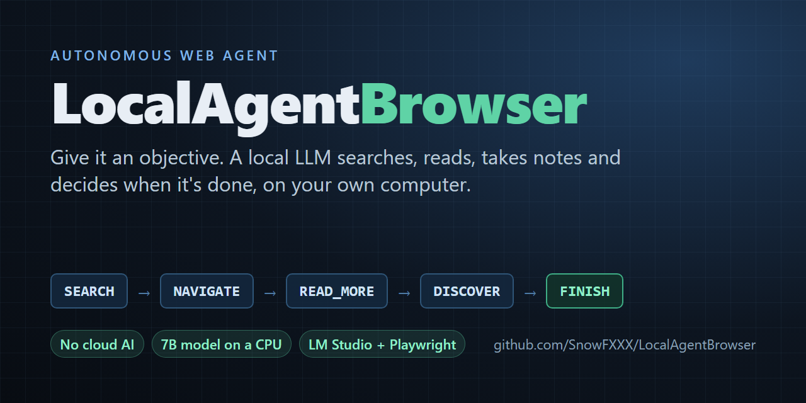
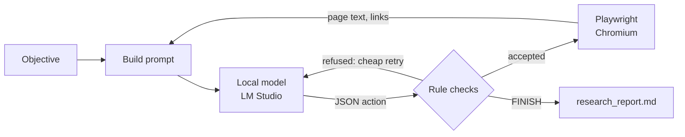

# LocalAgentBrowser

**An autonomous web agent powered by a local LLM. Give it an objective; it searches, reads, takes notes and
decides when it's done, all on your own computer.**

[](https://github.com/SnowFXXX/LocalAgentBrowser/actions/workflows/tests.yml)
[](LICENSE)

-green.svg)

<p align="center">
  
</p>

A local language model served by [LM Studio](https://lmstudio.ai) decides what to do next, and
[Playwright](https://playwright.dev/python/) carries it out in a visible Chromium window you can watch. Built
and tuned to work well with a **small 7B model on a CPU, no GPU required**.

- 🔒 **No cloud AI and no API keys.** The model runs in your own LM Studio.
- 🧭 **Goes from objective to findings unattended.** It searches, opens pages, reads long pages part by part,
  records what's relevant and finishes when the objective is met.
- 🛡️ **Keeps a small model on track.** Rules enforced in code stop loops, repeats and drifting, and the model
  is regularly asked to check its progress against the objective.
- ⚡ **Built for slow hardware.** It reuses LM Studio's prompt cache, so most turns process only what changed.
- 📝 **A readable report every time.** `research_report.md` holds the final result and every finding with its
  source, written however the run ends; `research_log.txt` keeps every action and reason.
- ✅ **Tested.** 89 tests on Linux and Windows, Python 3.10–3.13, run in about a second with no model or browser,
  plus live runs on six different kinds of task (see [results](#results-on-different-kinds-of-tasks)).

## Contents

[Quick start](#quick-start) · [What a run looks like](#what-a-run-looks-like) · [How it works](#how-it-works) ·
[Settings](#settings) · [Performance](#performance) · [FAQ](#faq) · [Limitations](#limitations) ·
[Roadmap](#roadmap) · [Contributing](#contributing)

## Quick start

1. Install [LM Studio](https://lmstudio.ai), download a model (developed with **Qwen2.5-7B-Instruct**),
   load it and start the local server (Developer tab → Start Server).
2. Install the agent:

   ```bash
   git clone https://github.com/SnowFXXX/LocalAgentBrowser.git
   cd LocalAgentBrowser
   python -m venv venv
   ```

   Activate the virtual environment (`venv\Scripts\activate` on Windows, `source venv/bin/activate` on macOS
   and Linux), then:

   ```bash
   pip install -r requirements.txt
   python -m playwright install chromium
   ```

3. Run it and type your objective:

   ```bash
   python agent_browser.py
   ```

   Or install it as a command with `pip install .` and run `localagentbrowser`. When it finishes, read
   `research_report.md`. Press Ctrl+C at any time to stop; the report is still written with everything found
   so far.

## What a run looks like

A complete real run with version 1.40, using the [live test runner](#testing) (which adds the timing lines);
repetitive status lines are left out and long lines are wrapped. Objective: *"What is the tallest mountain in
Africa, and how tall is it in meters and in feet?"*

```text
🧠 [TURN 1/100] Active reasoning cycle executing...
   (model call 38.6s, prompt=676 tok, completion=54 tok)
💡 Agent Thoughts: I need to find out the tallest mountain in Africa and its height in meters and feet.
   I should start by searching for this information.
🎬 Chosen Action: [SEARCH] -> Parameter: tallest mountain in Africa

🧠 [TURN 2/100] Active reasoning cycle executing...
⚡ Continuing the conversation (follow-up 1/12, ~1654 tokens)
   (model call 122.8s, prompt=1491 tok, completion=86 tok)
💡 Agent Thoughts: From the search results, I can see that Mount Kilimanjaro is mentioned as the tallest
   mountain in Africa ... I will navigate to one of these pages to find the exact height in meters and feet.
🎬 Chosen Action: [NAVIGATE] -> Parameter: https://en.wikipedia.org/wiki/Mount_Kilimanjaro

🧠 [TURN 3/100] Active reasoning cycle executing...
⚡ Continuing the conversation (follow-up 2/12, ~3693 tokens)
   (model call 347.3s, prompt=3753 tok, completion=84 tok)
💡 Agent Thoughts: The page provides the height of Mount Kilimanjaro in meters and feet. I will extract
   this information to complete the objective.
🎬 Chosen Action: [DISCOVER] -> Parameter: Mount Kilimanjaro is the highest mountain in Africa, with an
   elevation of 5,895 m (19,341 ft) above sea level.

🧠 [TURN 4/100] Active reasoning cycle executing...
⚡ Continuing the conversation (follow-up 3/12, ~3955 tokens)
   (model call 63.9s, prompt=3975 tok, completion=127 tok)
♻️ Cheap retry 1/2: [FINISH] refused. Your only discovery comes from
   https://en.wikipedia.org/wiki/Mount_Kilimanjaro. Consider whether the objective needs more. The current
   page still has 32 unread parts: use its outline to judge whether any of them is relevant before reading
   them. Before finishing, split the OBJECTIVE into its separate parts and, in thought_process, write each
   part followed by the discovery that covers it, or 'not covered'. ...
   (model call 80.6s, prompt=4368 tok, completion=97 tok)
💡 Agent Thoughts: The objective has two parts: the name of the tallest mountain in Africa and its height
   in meters and feet. Both are covered by the discovery from Mount Kilimanjaro's Wikipedia page.
🎬 Chosen Action: [FINISH] -> Parameter: The tallest mountain in Africa is Mount Kilimanjaro, which has an
   elevation of 5,895 meters (19,341 feet) above sea level.
🎯 Agent has signaled mission complete. Writing the final result...
   (model call 52.3s, prompt=312 tok, completion=41 tok)
🔒 Shutting down browser instance. Report: research_report.md; full journal: research_log.txt.
```

Four turns and 11.8 minutes of model time on a CPU: it searched, chose a page, recorded the answer, checked
each part of the question against what it had found before finishing, and then wrote the final result in a
separate step. The `research_report.md` it produced:

> **Status:** finished by the agent on turn 4
>
> **Final result:** The tallest mountain in Africa is Mount Kilimanjaro [1], and its elevation is 5,895 meters
> (19,341 feet) above sea level [1].
>
> **Discoveries (1)**
> 1. Turn 3, from https://en.wikipedia.org/wiki/Mount_Kilimanjaro: *Mount Kilimanjaro is the highest mountain
>    in Africa, with an elevation of 5,895 m (19,341 ft) above sea level.*

### Results on different kinds of tasks

Live runs on the development machine (CPU only, Qwen2.5-7B). Each kind of task is used to find and fix what
does not generalise; the [changelog](CHANGELOG.md) has the details.

| Kind of task | Objective (abridged) | Version | Outcome |
|---|---|---|---|
| Documentation research | Setup commands and file layout for Playwright's test agents | 1.27 | Finished on its own in 13 turns (~36 min) with commands, roles and file layout |
| Documentation research, strict | The same, but "do not FINISH until fully validated", including "parameter schemas" | 1.38–1.40 | Its most detailed findings (per-client setup, seed test, agent definition files), but it keeps searching for schemas the docs do not contain and has not finished within an hour |
| Opinion from several sources | How spiritual traditions view cats, then form an opinion | 1.30 | Six traditions from two sources and a stated opinion, in 18 turns (37 min of model time) |
| Factual question | Tallest mountain in Africa, height in meters and feet | 1.35, 1.40 | Correct, cited answer in 4 turns (about 12 min of model time) in both versions; before 1.35 it kept reading after finding it |
| Comparison and recommendation | Python vs Rust for command-line tools; recommend one for a beginner | 1.36 | Cited comparison of performance, learning and Python's libraries, recommending Python, in 16 turns (33 min); Rust's libraries were not covered |
| List of items | Three free, open-source Photoshop alternatives and the strengths of each | 1.37–1.38 | GIMP, Krita and Darktable with their strengths, all cited, in 9 turns (24 min); 1.37 listed a fourth and added an unrequested opinion, which 1.38 fixes |
| Step-by-step how-to | Make a sourdough starter, with quantities and what to do each day | 1.36–1.37 | A clear plan in 7 turns (19 min), but it invented the first water amount; 1.37 stops guessing and flags unsupported numbers, and the agent then went looking for the missing details |

## How it works

Each turn, the model sees the objective, what it has found so far, a journal of its recent actions and the
current page, and answers with exactly one JSON action:

| Action | What it does |
|---|---|
| `SEARCH` | Searches DuckDuckGo (HTML version) and shows a numbered list of results with their real URLs |
| `NAVIGATE` | Opens a URL taken from the results or from the current page's links |
| `READ_MORE` | Shows the next part of a long page (pages are read in parts of about 2,500 characters) |
| `DISCOVER` | Records information from the current page as a finding |
| `FINISH` | Ends the run (after checking each part of the objective is covered); the final result is then written in a separate step |



### Keeping a small model on track

- **Rules enforced in code, not just stated in the prompt.** Repeated searches, visiting the current page,
  empty or duplicate findings and impossible `READ_MORE` requests are refused, and the model is told why.
  Duplicate findings are recognised even when reworded into different lines, punctuation or order.
- **Cheap retries.** A refused reply is corrected inside the same turn by appending a short note to the
  conversation, instead of wasting a whole turn.
- **Confirm before leaving.** Leaving a page without recording anything from it triggers one check: record
  something, or repeat the action to leave.
- **Knowing when it's done.** After every new finding the model is asked whether the objective is now fully
  covered, and if so to finish instead of reading on for extra details.
- **Progress and objective checks.** After 4 turns without a new finding, and every 8 turns regardless, the
  model is asked to check each part of the objective against its findings, then finish or name what is still
  missing. Finishing itself gets the same part-by-part check (with the number of sources and any unread parts
  of the current page), and a finish whose own check lists a part as "not covered" is sent back to work on it.
  A part that cannot be found after several tries can be reported as missing instead of blocking for good.
- **Writing is a separate step.** When the agent finishes, one more model call writes the final result from
  only the objective and the recorded findings, under a short list of rules: no guessing or outside knowledge,
  cite findings by number, give exactly as many items as asked for, and add a "My view:" paragraph only when
  the objective asks for an opinion. A small model writes far better when that is its only job, and every
  claim stays traceable to a recorded finding. The report flags any number in the final result that appears
  in none of the findings, the most harmful kind of slip in a how-to.
- **Error pages are recognised.** A page answering 404, 403 and so on counts as a failed visit, not content.
- **Readable pages.** Navigation menus, footers and cookie banners are hidden; code blocks and tables are
  never split between parts; links already shown are not repeated. Long pages come with an outline of the
  headings in each part, marking the parts already read, so the agent can jump to the part it needs instead of
  reading in order.

### Built for slow hardware

On a CPU, reading the prompt is about 90% of the time of every model call, and LM Studio can skip whatever
part of a prompt matches the start of its previous one. So the agent keeps one growing conversation and only
appends what changed (a short result, the next page part or a new page), building a fresh prompt only when
the conversation nears the context limit. The journal uses a compact one-line-per-entry format.

## Settings

| Environment variable | Default | Meaning |
|---|---|---|
| `LMSTUDIO_BASE_URL` | `http://localhost:1234/v1` | Address of the OpenAI-compatible server |
| `LMSTUDIO_MODEL` | `qwen2.5-7b-instruct` | Model identifier as the server lists it |
| `LMSTUDIO_API_KEY` | `lm-studio` | API key, if your server requires one |
| `LMSTUDIO_CONTEXT_LENGTH` | `8192` | Context length the model is loaded with; the conversation budget follows it |

Behaviour limits (part size, retry counts, check intervals and so on) are named constants at the top of
`agent_browser.py`, each with a comment explaining it.

## Performance

Measured on an Intel i5-9500 (6 cores, no GPU) with Qwen2.5-7B-Instruct Q4_K_M at an 8,192-token context:

| Kind of turn | Typical time |
|---|---|
| Follow-up on the same page (finding recorded, cheap retry) | 35–60 s |
| Next part of a page, or a new page appended | 100–280 s |
| First turn of a run | 45–110 s |
| Fresh prompt after the context budget is reached | 160–380 s (longest with long pages) |
| Writing the final result (once, at the end) | 50–190 s, depending on how much was found |

Whole runs from the results table: a factual question in about 12 minutes of model time, a list of three items
in 24, a comparison in 33. A GPU or a smaller model will be much faster.

## FAQ

**Does it need a GPU?**
No. It was developed entirely on a CPU. A GPU just makes each turn faster.

**Which models work?**
It was developed and tested with Qwen2.5-7B-Instruct (Q4_K_M). Any instruction-tuned model that LM Studio
serves should work, as long as the server supports `response_format` with a JSON schema (LM Studio 0.3 and
later). Set `LMSTUDIO_MODEL` and `LMSTUDIO_CONTEXT_LENGTH` to match. Reports with other models are very welcome.

**Can I use another OpenAI-compatible server instead of LM Studio?**
Probably: point `LMSTUDIO_BASE_URL` at it. It has only been tested with LM Studio, and the speed tricks rely
on the server reusing cached prompt prefixes (llama.cpp-based servers do).

**Is anything sent to the internet?**
No AI service is involved, and nothing about your run is uploaded. The agent does browse the real web,
though: search queries go to DuckDuckGo, and pages it opens load normally, as if you visited them yourself.

**Where are the results?**
In the folder you ran it from: `research_report.md` has the final result and every finding with its source,
and `research_log.txt` has the full journal of actions and reasons, updated after every turn.

**Why does a turn take minutes?**
On a CPU the model reads the prompt slowly (about 8 tokens per second on the development machine), so a
turn that brings in a new page takes a few minutes. See [Performance](#performance) and
[Built for slow hardware](#built-for-slow-hardware).

## Limitations

- **Tried on six kinds of task so far** (see [results](#results-on-different-kinds-of-tasks)): documentation
  research, an opinion from several sources, a factual question, a comparison, a how-to and a list. Each one
  exposed something that did not generalise and was fixed; other kinds of tasks may expose more.
- **Reading without recording.** The model sometimes reads a long page part by part without recording the
  relevant parts, even with the outline in front of it. This is currently its main weakness.
- **A small model's judgement is the ceiling.** It sometimes drifts to loosely related pages, prefers
  secondary sources or stays with one source too long, and results vary with the first pages a search turns
  up; every finding is in `research_report.md` regardless.
- **Very strict objectives can keep it searching.** An objective that forbids finishing until everything is
  "fully validated" can keep the agent looking for something the web may not contain. It is told to finish
  and name what it could not find after looking in several places, but a 7B model does not always judge
  when that point has come; the turn limit (100) and Ctrl+C still apply, and the report is always current.
- **Check the citations.** The final result only uses recorded findings, but a 7B model sometimes puts the
  wrong number on a citation, so verify a claim against the listed findings before relying on it.
- **Some sites refuse automated browsers** (HTTP 403). The agent respects that and does not try to disguise
  itself; it moves on to other sources.
- **Reading only.** The agent searches, opens pages and reads them. It does not click, fill in forms or sign in.
- **Web pages go into the prompt.** A page can contain text written to manipulate the model (prompt
  injection), so treat findings as unverified. See [SECURITY.md](SECURITY.md).
- **One search provider.** DuckDuckGo's HTML search occasionally returns an error page; the agent retries once.

## Roadmap

- [x] Include every finding in the final report, not only the model's own summary (1.29)
- [x] Write the final result in a separate, rule-bound step and flag unsupported numbers (1.32–1.38)
- [x] Finish as soon as the objective is covered (1.35)
- [ ] Get the model to record relevant parts while it reads long pages
- [ ] Let very strict objectives end with the gaps named instead of searching indefinitely
- [ ] Try more kinds of objectives (six so far) and adjust the rules that don't generalise
- [ ] Make fresh prompts (the slowest kind of turn) cheaper still (31% cheaper since 1.34)
- [ ] Interacting with pages (clicking, forms) for tasks beyond reading

Ideas and requests are welcome in [issues](https://github.com/SnowFXXX/LocalAgentBrowser/issues).

## Testing

The test suite runs in about a second and needs neither LM Studio nor a browser: the model and the website
are replaced by scripted fakes, including an end-to-end run of the main loop.

```bash
pip install -r requirements-dev.txt
python -m pytest
python -m ruff check .
```

To try the real agent with a fixed objective and a time limit, logging the time and tokens of every model
call:

```bash
python tools/live_test.py "Your objective here" --minutes 25
```

## Contributing

Contributions are welcome! See [CONTRIBUTING.md](CONTRIBUTING.md) for setup and guidelines, and please follow
the [Code of Conduct](CODE_OF_CONDUCT.md). Security issues: see [SECURITY.md](SECURITY.md).

## Project history

Every version is a tagged commit, and [CHANGELOG.md](CHANGELOG.md) describes what changed in each one and
why, with the measurements behind the decisions.

## Acknowledgements

Versions 1.13 onwards were developed together with [Claude](https://www.anthropic.com/claude) (Anthropic),
working in Claude Code; those commits list Claude as co-author. Built on [LM Studio](https://lmstudio.ai),
[Playwright](https://playwright.dev/python/) and the [OpenAI Python library](https://github.com/openai/openai-python).

## License

[MIT](LICENSE) © 2026 SnowFX
