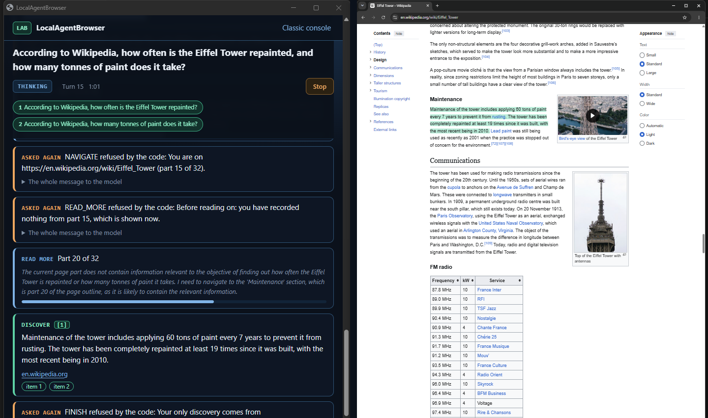

# LocalAgentBrowser Clean Room

**Clean Room is a private edition of [LocalAgentBrowser](https://github.com/SnowFXXX/LocalAgentBrowser):** an
autonomous web research agent with checked answers, run by a language model on your own PC in
[LM Studio](https://lmstudio.ai), with a Chromium browser you can watch.

The full edition can also use hosted AI models over the internet, if you turn that on. Clean Room doesn't have that
option at all: the code for it is removed before the edition is built, not just switched off, and the build fails if
any of it is left. What Clean Room connects to:

- **The model server:** LM Studio on this PC, or another machine on your own network. Clean Room refuses any other
  address, whatever `LMSTUDIO_BASE_URL` says.
- **The search engine** (DuckDuckGo) and **the pages the agent reads**, the same as a person browsing.
- During setup only: the Chromium browser download, and the model you pick (from Hugging Face, through LM Studio).

Your objective, the pages read and the report stay on your PC. Each run writes its research log and report to its
own folder.

## Install

### Windows: the installer

1. Install [LM Studio](https://lmstudio.ai) (free).
2. Download **`LocalAgentBrowser-CleanRoom-<version>-setup.exe`** from the
   [latest release](https://github.com/SnowFXXX/LocalAgentBrowser/releases/latest) and run it.
   - Windows may say **"Windows protected your PC"**, because the installer isn't code-signed yet. Click
     **More info → Run anyway**.
   - It installs for your Windows account only, with no administrator rights, and brings its own Python.
   - It installs beside the full edition, in its own folder (`LocalAgentBrowser Clean Room`) with its own
     shortcuts, so you can have both.
3. Setup asks which of the tested models to download through LM Studio, then downloads the Chromium browser the agent
   uses (about 150 MB, once).
4. Open **LocalAgentBrowser Clean Room** from the Start menu or the desktop: from 1.68 it opens in a window of its
   own. **LocalAgentBrowser Clean Room (classic console)** in the Start menu opens the console instead.

To remove it: **Start menu → LocalAgentBrowser Clean Room → Uninstall**, or Windows Settings → Apps. Your reports in
Documents are kept.

### Any system: pip

You need Python 3.10 or later and LM Studio.

```bash
python -m venv venv
venv\Scripts\activate
pip install localagentbrowser-cleanroom
python -m playwright install chromium
```

On macOS or Linux, activate with `source venv/bin/activate` instead. The package installs the same `localagentbrowser`
command and module as the full edition, so install one or the other in a given environment, not both.

## First run

1. In LM Studio, load your model with a **context length of 8192** and start the local server (Developer tab → Start
   Server).
2. Start LocalAgentBrowser Clean Room: the Start-menu shortcut on Windows, or `localagentbrowser` in a terminal on
   other systems.
3. **On Windows, a window opens on a start screen.** Type your objective, for example *What is the tallest mountain
   in Africa, and how tall is it in meters and in feet?*, check the model from LM Studio's list, and click
   **Start research**.
4. **The window moves to the left and the agent's browser opens on the right.** The live view shows the parts of the
   objective as chips that light up as each is answered, a card for each action (the checks' refusals included), and
   a timer while the model thinks. The first step takes a minute or two on a CPU. In the browser, the page scrolls to
   the part being read and marks each finding in mint (`LAB_FOLLOW=0` turns this off). **Stop** ends a run at any
   time.
5. **When it finishes, the report appears in the same window**, with buttons to open it as a page or open its
   folder. Runs each get their own folder under **Documents\LocalAgentBrowser runs**, and the start screen lists
   recent ones. Minimized, the window goes to the notification area.

<p align="center">
  
</p>
<p align="center"><sub>The window beside the agent's browser, shown in the full edition: Clean Room's is the same, titled
LocalAgentBrowser Clean Room.</sub></p>

**The classic console** is one click away: **Classic console** at the top of the window opens it and keeps it as your
choice; type `/ui` as the objective there to come back. On other systems, the console asks for an objective and
opens the report in your browser when the run ends.

A run takes about 10 to 60 minutes on a CPU. Stop it at any time (**Stop** in the window, Ctrl+C in the console): the
report is still written with everything found so far.

## Settings

| Environment variable | Default | Meaning |
|---|---|---|
| `LMSTUDIO_BASE_URL` | `http://localhost:1234/v1` | LM Studio's address: this PC or your own network only |
| `LMSTUDIO_MODEL` | `qwen2.5-7b-instruct` | Model identifier as LM Studio lists it |
| `LMSTUDIO_API_KEY` | `lm-studio` | A key, if your LM Studio server requires one |
| `LMSTUDIO_CONTEXT_LENGTH` | `8192` | Context length the model is loaded with |
| `LAB_SIDE_BY_SIDE` | on | On Windows, `0` keeps the console and the browser from being placed side by side |
| `LAB_FOLLOW` | on | `0` keeps the agent's browser from scrolling to the part read and marking findings |
| `NO_COLOR`, `LAB_COLOR` | colour on | `NO_COLOR` set, or `LAB_COLOR=0`, keeps the classic console's text plain |

The window keeps its choices (the model, the time limit, the reports folder, and whether you prefer the classic
console) in `%APPDATA%\LocalAgentBrowser\settings.json`; uninstalling removes it.

## More

How the agent works, what it was tested on and its limitations are in the
[project README](https://github.com/SnowFXXX/LocalAgentBrowser#readme) and
[How it works](https://github.com/SnowFXXX/LocalAgentBrowser/blob/main/docs/how-it-works.md). Clean Room runs the
same agent and the same checks as the full edition, from the same code.

MIT License; see `LICENSE`.
