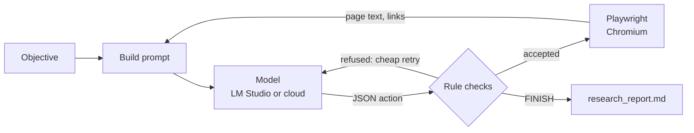

# How LocalAgentBrowser works

The details behind the README's short version: the actions, the code layout, the rules that keep a small model on track, and how it stays usable on a CPU.

## The loop

Each turn, the model sees the objective, what it has found so far, a journal of its recent actions and the
current page, and answers with exactly one JSON action:

| Action | What it does |
|---|---|
| `SEARCH` | Searches DuckDuckGo (HTML version) and shows a numbered list of results with their real URLs |
| `NAVIGATE` | Opens a URL taken from the results or from the current page's links |
| `READ_MORE` | Shows the next part of a long page (pages are read in parts of about 2,500 characters), or the unread part whose outline label names an item still missing |
| `DISCOVER` | Records information from the current page as a finding |
| `FINISH` | Ends the run (after checking each part of the objective is covered); the final result is then written in a separate step |

## Code layout

The code is in the `localagentbrowser` package, one file per job, each depending only on the ones above it:

| File | What it holds |
|---|---|
| `config.py` | Settings: the LM Studio connection (from environment variables) and every limit and threshold |
| `prompts.py` | Every fixed text the model reads: the system prompt, turn instructions, the checklist, coverage and final-result prompts |
| `text.py` | Small word helpers the checks share |
| `pages.py` | Reading the web: search results, page parts, the outline and its pointer, links |
| `grounding.py` | Whether a finding is really on the page shown, or already recorded |
| `checklist.py` | The objective split into a fixed checklist, and findings linked to its items |
| `coverage.py` | The coverage check before finishing, verified in code, and what is reported as not found or not proven |
| `checks.py` | Decisions refused or confirmed before they are carried out (leaving, reading on, finishing, ...) |
| `report.py` | The journal, the research log, the final result and the report file |
| `agent.py` | The loop: each turn's conversation with the model, in-turn retries, and `main()` |

`agent_browser.py` keeps `python agent_browser.py` working from a clone.

## Keeping a small model on track

- **Rules enforced in code, not just stated in the prompt.** Repeated searches, visiting the current page,
  empty or duplicate findings and impossible `READ_MORE` requests are refused, and the model is told why.
  Duplicate findings are recognised even when reworded into different lines, punctuation or order.
- **Cheap retries.** A refused reply is corrected inside the same turn by appending a short note to the
  conversation, instead of wasting a whole turn.
- **Confirm before leaving or reading on.** Leaving a page without recording anything from it triggers one
  check: record something, or repeat the action to leave. Moving on to the next part of a page works the same
  way, and the model must first list what the part it is on says about the objective (or "none").
- **Findings must match the page.** A finding that shares too few word pairs with the page text shown so far
  (or has a sentence that does) is sent back once, asking for only what the page says in its own words, and
  one far from anything on the page is refused outright. A small model will otherwise "complete" a list from
  its own knowledge when a page says "follow these 6 steps" and the steps come later. The refusal points the way:
  it quotes the one page sentence closest to what the model wrote, to record instead, or names what the parts
  shown never mention ("Japan, Navajo"), so the model reads on.
- **Commands must be on the page, exactly.** Commands and paths in a finding (in backticks, in a code block, or
  any word with a backslash, a `<placeholder>` or two slashes) must appear on the page as written, however often
  the finding is repeated. Word matching cannot catch a wrong command: a 7B recorded `pip install package_name`,
  which the official page never gives, and swapped `bin` and `Scripts` when copying its activation table. The same
  goes for the final result: a command no finding gives is cut and named after the result.
- **An objective checklist.** At the start, one short model call splits the objective into a fixed checklist of
  what the result must contain, keeping conditions like "free, open-source" or "three". Each finding names the
  items it serves, the checklist with its findings is in every prompt, and every check goes through these items
  instead of asking the model to split the objective again from memory, which drifted: it once blocked its own
  finish over "migration strategies", which the objective never asked for. Opinion items are shown as written
  at FINISH, not as gaps to fill, and the first search covers the whole objective in one short query, keeping
  its conditions ("official python documentation venv").
- **A coverage check before finishing.** Each checklist item is checked against the findings in a short call of
  its own, and the code checks the verdict instead of taking it on trust: an item nothing was copied for, fewer
  things than asked for ("only 1 of 3 found"), and things not shown, in words copied from a finding about them,
  to meet a condition such as "open-source". A claim that something is missing is dropped when every word of it is
  already in the findings. Only gaps the code verifies send the FINISH back, once: an item nothing was copied for,
  fewer things than asked for ("only 1 of 3 found"), or nothing recorded. The model's other verdicts, and things
  not shown to meet a condition, only shape the final result. The send-back names the next step, and the next turn
  starts from a fresh prompt.
- **Numbered findings.** Findings are numbered in the prompt and listed with every check, and the model names
  the finding that covers each part of the objective ("covered by [2]") instead of just saying "covered".
- **Knowing when it's done.** After every new finding the model is asked whether the objective is now fully
  covered, and if so to finish instead of reading on for extra details.
- **Progress and objective checks.** After 4 turns without a new finding, and every 8 turns regardless, the
  model is asked to check each part of the objective against its findings, then finish or name what is still
  missing. Finishing itself gets the same part-by-part check (with the number of sources and any unread parts
  of the current page), and a finish whose own check lists a part as "not covered" is sent back to work on it.
  A part that cannot be found after several tries can be reported as missing instead of blocking for good.
- **Writing is a separate step.** When the agent finishes, one more model call writes the final result from
  only the objective and the recorded findings, under a short list of rules: no guessing or outside knowledge,
  cite findings by number, give as many items as asked for (never repeating one, and saying how many were not
  found), and add a "My view:" paragraph only when the objective asks for an opinion. A small model writes far
  better when that is its only job, and every claim stays traceable to a recorded finding. What no finding
  answers is not left to the model: those checklist items are left out of what it is asked to write, and the code
  adds them after the result as "Not found in the pages read". A thing not shown to meet a condition stays in the
  result, and the code marks it where it is first named ("not shown in the pages read to be open-source"), or lists
  it after the result if the result does not name it. The report flags any number in the final result that appears in
  none of the findings, the most harmful kind of slip in a how-to.
- **Error pages are recognised.** A page answering 404, 403 and so on counts as a failed visit, not content.
- **Readable pages.** Navigation menus, footers, cookie banners and site notices such as fundraising banners are
  hidden; code blocks and tables are
  never split between parts; links already shown are not repeated. Long pages come with an outline of the
  headings in each part, marking the parts already read, so the agent can jump to the part it needs instead of
  reading in order.

## Built for slow hardware

On a CPU, reading the prompt is about 90% of the time of every model call, and LM Studio can skip whatever
part of a prompt matches the start of its previous one. So the agent keeps one growing conversation and only
appends what changed (a short result, the next page part or a new page), building a fresh prompt only when
the conversation nears the context limit. The journal uses a compact one-line-per-entry format.

## Performance

Measured on an Intel i5-9500 (6 cores, no GPU) with Qwen2.5-7B-Instruct Q4_K_M at an 8,192-token context:

| Kind of turn | Typical time |
|---|---|
| Follow-up on the same page (finding recorded, cheap retry) | 35–60 s |
| Next part of a page, or a new page appended | 100–280 s |
| First turn of a run | 45–110 s |
| Fresh prompt (context budget reached, or after a coverage send-back) | 160–540 s (longest with long pages) |
| Coverage check before finishing (all checklist items) | about 1–3 min |
| Writing the final result (once, at the end) | 50–190 s, depending on how much was found |

Whole runs vary with the pages a search turns up. In the regression runs since 1.53, a factual question took 9 to
19 minutes of model time; the list, comparison, how-to, opinion and documentation tasks 17 to 44 when they finished;
and the explanation 13 to 59. A whole suite of seven tasks took 171 to 272 minutes up to 1.63, and 262 to 361 minutes for the 7B on 1.64 (stricter checks, two PCs). A GPU or a smaller model will be much faster.

## Limitations

- **Tried on seven kinds of task so far** (see [task results](task-results.md)): documentation
  research, an opinion from several sources, a factual question, a comparison, a how-to, a list and an
  explanation of a topic. Each one
  exposed something that did not generalise and was fixed; other kinds of tasks may expose more.
- **Judging whether a finding covers an item is the weakest area.** The model's verdict is unreliable both ways:
  on 1.53 the explanation finished from one overview paragraph without oxygen or water, and in the regression runs
  since 1.54 about half of the coverage check's send-backs were for gaps that were not real ("missing official
  documentation" on a comparison that did not ask for it, "H2O, O2" already recorded). Since 1.58 the agent is sent
  back only for what the code verifies (an item nothing answers, fewer things than asked for); the model's other
  verdicts only shape the final result, so a thin answer can still pass (on 1.61 the comparison's "many
  simultaneous users" part is short).
- **Conditions in the objective.** A small model tends to drop conditions such as "open source" or "using the
  official documentation": a list of open-source office suites once included FreeOffice (free but not open
  source), and a task that asked for the official Python documentation used a tutorial site. The objective
  checklist keeps the conditions in view (the documentation task uses python.org since 1.55), and a thing not
  shown in the findings to meet a condition is marked where it is named ("not shown in the pages read to be free
  and open-source"). The mark says what the pages read did not show, not that the thing fails the condition: on
  1.61 it marked LibreOffice and OnlyOffice, which are open source, as well as WPS Office, which is not. Check the
  result against any conditions you set.
- **A small model's judgement is the ceiling.** It sometimes drifts to loosely related pages, prefers
  secondary sources or stays with one source too long, and results vary with the first pages a search turns
  up; every finding is in `research_report.md` regardless.
- **Very strict objectives.** An objective that forbids finishing until everything is "fully validated" used
  to keep the agent looking for something the web may not contain. On 1.50 it finished such an objective in 25
  minutes, but with thin findings and without naming what it could not find, so check the result against the
  objective. Since 1.57 the code lists checklist items no finding answers after the result; this has not been
  tested on a strict objective yet.
- **Check the citations.** The final result is told to use only recorded findings, but a 7B model sometimes
  puts the wrong number on a citation, adds a line no finding supports, leaves out a step or misreads a part of
  the question (on 1.57 it answered "how long it keeps in the fridge" with the steeping time), so verify a claim
  against the listed findings before relying on it.
- **Some sites refuse automated browsers** (HTTP 403). The agent respects that and does not try to disguise
  itself; it moves on to other sources.
- **Reading only.** The agent searches, opens pages and reads them. It does not click, fill in forms or sign in.
- **Web pages go into the prompt.** A page can contain text written to manipulate the model (prompt
  injection), so treat findings as unverified. See [SECURITY.md](https://github.com/SnowFXXX/LocalAgentBrowser/blob/main/SECURITY.md).
- **One search provider.** DuckDuckGo's HTML search occasionally returns an error page; the agent retries once.
